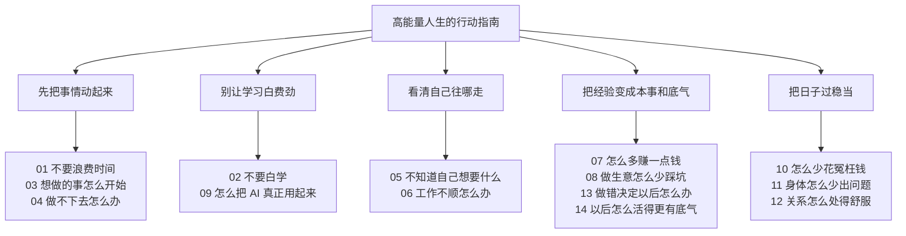

# 高能量人生的行动指南

今天，先让一件小事发生。

想做的事，先做30秒。

## 你今天卡在哪儿？

- 想了半天，手还没动 → [[#001｜想做的事，先做30秒|001　先做 30 秒]]
- 忙了一上午，正事还没碰 → [[#003｜每天先确定一件重要的事|003　先定一件重要的事]]
- 断了几天，不想捡起来 → [[#016｜断了几天，先接回一小步|016　先接回一小步]]
- 一句气话，在脑子里来回转 → [[#098｜同一句气话在脑子里转第三遍，先去洗个杯子|098　先去洗个杯子]]

### ⚡ 30秒行动急救索引（遇到卡点直接照着做）

| 你现在的卡点 | 第一步动作 | 第二步动作 | 直达卡片 |
| :--- | :--- | :--- | :--- |
| **想了半天，手还没动** | 开录音 | 说一句 | [[#001｜想做的事，先做30秒\|001 先做30秒]] |
| **忙了一上午，正事还没碰** | 挑一件 | 定结果 | [[#003｜每天先确定一件重要的事\|003 先定一件正事]] |
| **断了几天，完全不想捡起来** | 找断点 | 续一句 | [[#016｜断了几天，先接回一小步\|016 接回一小步]] |
| **刚学完挺明白，隔几天全忘了** | 挑一招 | 立刻用 | [[#004｜学完一个东西，马上用一次\|004 马上用一次]] |
| **两件事情反复纠结拿不定主意** | 立假设 | 定低成本试 | [[#006｜不知道怎么选，先做个小实验\|006 跑个小实验]] |
| **跟 AI 较劲十轮越改越烂** | 做2次 | 动手改 | [[#120｜让 AI 自己改一份稿，先说好几轮停手\|120 做2次动手改]] |
| **会员每个月悄悄被扣款** | 查扣费 | 关续费 | [[#042｜不用的会员，别让它继续扣钱\|042 关掉免密续费]] |
| **争执结束，一句气话在脑子里转** | 动动手 | 问手头 | [[#098｜同一句气话在脑子里转第三遍，先去洗个杯子\|098 先去洗个杯子]] |
| **半夜特别想发长小作文拍板** | 存草稿 | 天亮看 | [[#110｜深夜写好的重要回复，能等就先存草稿\|110 存草稿天亮看]] |
| **一件大活干完只剩下脱力** | 留一样 | 存到位 | [[#034｜每次做完，留一个下次能用的东西\|034 留个下次能用的]] |

[[#章节目录|按 14 章找问题]] · [[#内容全景图|看全书地图]] · [[#富贵为什么写这本书|认识富贵]]

## 章节目录

- [[#01｜不要浪费时间]] · 18条行动
- [[#02｜不要白学]] · 8条行动
- [[#03｜想做的事怎么开始]] · 5条行动
- [[#04｜做不下去怎么办]] · 7条行动
- [[#05｜不知道自己想要什么]] · 7条行动
- [[#06｜工作不顺怎么办]] · 3条行动
- [[#07｜怎么多赚一点钱]] · 4条行动
- [[#08｜做生意怎么少踩坑]] · 7条行动
- [[#09｜怎么把 AI 真正用起来]] · 9条行动
- [[#10｜怎么少花冤枉钱]] · 3条行动
- [[#11｜身体怎么少出问题]] · 13条行动
- [[#12｜关系怎么处得舒服]] · 11条行动
- [[#13｜做错决定以后怎么办]] · 6条行动
- [[#14｜以后怎么活得更有底气]] · 4条行动

---

## 01｜不要浪费时间

一天到晚事儿那么多，先分清楚：哪件今天必须往前推，哪件交给工具替你记，哪件得在日历上占个坑。

**开工前**

- [[#003｜每天先确定一件重要的事|003　消息回了半天，自己的正事还没开头]]
- [[#005｜重要的事情，不要只靠记忆|005　脑子里总吊着一句“千万别忘了”]]
- [[#011｜总说有空再做，就给它留个时间|011　嘴上说“有空再弄”，日历上却没它的位置]]
- [[#038｜别凭感觉答应，先看上次做了多久|038　一句“明天肯定交”，往往只算了敲字的时间]]
- [[#102｜最清醒的那一小段，留给需要你拿主意的事|102　脑子最清醒的时候，总在收拾小事]]

**容易分心时**

- [[#037｜开工前，先让手机安静一会儿|037　刚找到写稿的思路，手机又亮了]]
- [[#061｜不急的消息，攒到手头这件事做完再回|061　算账算到一半，群里有人问下周去哪聚餐]]
- [[#091｜想少刷一会儿，给最容易刷过头的那个应用设个限额|091　等外卖时点了个视频，吃完饭还在往下划]]
- [[#092｜同一行读了三遍，换个安静的地方把它读完|092　同一行读到第三遍，旁边电话里的话你倒是听清了]]
- [[#103｜被叫走前，给自己留一句“回来先干啥”|103　账对到一半，同事叫你去看样品。人已经站起来了，脑子还在记第几行]]

**要跟别人配合时**

- [[#053｜喊大家开会前，先说清今天要定哪件事|053　会议通知只写“下午聊聊”，大家不知道该带什么]]
- [[#097｜只想让大家知道进度，就发三行字|097　大家只是需要知道进度，又要约齐五个人开会]]
- [[#101｜接新工作前，先看哪件事得往后放|101　手头三件事还没做完，又有人让我干活]]

**想少花一点时间时**

- [[#054｜想花钱省时间，先说清省下来干什么|054　想花钱请人做家务，又舍不得这笔钱]]
- [[#071｜在长文件里找一句话，先搜最特别的那个词|071　附件二十页，眼前只想知道最迟哪天报销]]

**少切换、少输入时**

- [[#107｜同一段活儿，桌上只留它用得着的窗口|107　报价表、聊天和新闻并排亮着，眼睛一抬就有三个去处]]
- [[#108｜查完要紧的消息，就从新闻页出来|108　本来只想看明天有没有停课通知，十分钟后已经在翻外地的热搜]]
- [[#114｜改一份稿，一遍只看一件事|114　改了三个错字，又觉得整段该删，刚才那几分钟白花了]]

### 003｜每天先确定一件重要的事

消息回了半天，自己的正事还没开头。

**现在就做**

- [ ] **挑一件**　拿出纸笔，只写下一件今天最想往前推的正事。
- [ ] **定结果**　紧接着补一句：“今天做到哪一步，就算能交差收工？”

**你要付出**　花 2 分钟；得先把微信里那些不急的闲聊晾在一边。

**你能得到**　今天一天有了主心骨，不再被别人拉着到处救火。

**富贵的故事**　做天猫那几年，我每天一睁眼就是几千条旺旺消息。如果一早就陷在回消息里，这一整天就废了。后来我立了规矩：每天早上先关掉聊天窗口，只定一件事——比如把主图改好，或者把供货商账期谈妥。这一件事落地了，今天就没白过。

**下次接着做**　明天开工前，先在便签纸上写下今天的这一件事再开电脑。

依据与说明

**原卡标记**　🔨 亲身经历 · ⚡ 马上做

**⚠️ 注意**：遇到家里有事、临时救火的日子，重点随时可以换。挑一件最重要的事，不是让你把别的正事全扔了。

**📖 深读**：[[04_Projects/进行中/2026-10 高能量人生的行动指南/high-energy-action-guide/README|README]]

沿用原行动卡中作者对每日工作台的自述，没有提供效果对比数据。“每天一件事”“最多三个项目”是个人规则，不是普遍标准；时间为估计。

**素材依据**：

- [[04_Projects/进行中/2026-10 高能量人生的行动指南/high-energy-action-guide/README|README]]
- [[04_Projects/行动系统/每周复盘/2026-10-19 人机协作阶段复盘|2026-10-19 人机协作阶段复盘]]

---

### 005｜重要的事情，不要只靠记忆

脑子里总悬着一句“千万别忘了”，越想越焦虑。

**现在就做**

- [ ] **写进日历**　只要事情带截止时间，立刻写进手机日历，标清具体几点、办什么。
- [ ] **设提醒**　定一个提前 15 分钟的闹钟，看一眼手机或手表能不能震动提醒。

**你要付出**　花 1 分钟；别相信自己的脑子能记住所有琐事。

**你能得到**　脑子彻底卸下包袱，不用整天提心吊胆怕漏事。

**富贵的故事**　我常跟学员说：人的脑子是用来琢磨主意的，不是用来当记事本的。把琐事往日历里一扔，闹钟一设，你就该吃吃该喝喝。到了点系统自然会喊你，省下那几斤八两的精神头干正事。

**下次接着做**　只要听到别人说“周五前给我”，手立刻摸向日历建日程。

依据与说明

**原卡标记**　🔨 亲身经历 · ⚡ 马上做

**⚠️ 注意**：装灵感的收件箱不能代替到点儿响的闹钟；记下来的东西如果涉及别人隐私，保存时留个心眼。

**📖 深读**：[[04_Projects/进行中/2026-10 廖富贵的人生进阶指南/01_章节母稿/07_第1篇_04_个人大脑搭建：别再搭完美知识库了，先让Obsidian替你干活|07_第1篇_04_个人大脑搭建：别再搭完美知识库了，先让Obsidian替你干活]]

根据作者原卡与知识库母稿整理。随手记录是已有做法；本条提醒流程未提供效果测试，记录时应处于适合操作手机的安全场景。

**素材依据**：

- [[04_Projects/进行中/2026-10 廖富贵的人生进阶指南/01_章节母稿/07_第1篇_04_个人大脑搭建：别再搭完美知识库了，先让Obsidian替你干活|07_第1篇_04_个人大脑搭建：别再搭完美知识库了，先让Obsidian替你干活]]
- [[04_Projects/进行中/2026-10 高能量人生的行动指南/high-energy-action-guide/README|README]]

**工具表（旧版，可按需取用）**：[[04_Projects/进行中/2026-10 廖富贵的人生进阶指南/03_读者行动工具表/07_Obsidian极简第二大脑工作流自检卡|07_Obsidian极简第二大脑工作流自检卡]]。其中的数字、定价、固定时限和效果承诺不视为已验证标准。

---

### 011｜总说有空再做，就给它留个时间

嘴上总说“有空再弄”，日历里却从来没给它留过坑。

**现在就做**

- [ ] **圈时间**　翻开日历，找一段这周确实空着的半小时，把它当成正式约会定下来。
- [ ] **写第一步**　在日程标题旁写上第一步动作（比如“打开第3章文档写开头”）。

**你要付出**　花 2 分钟翻日历；到点真得按时坐下来动这一下。

**你能得到**　想做的事不再飘在空中，在你的真实时间里有了着落。

**富贵观察**　成年人的世界里，“改天”就是“不再见”，“有空再做”就是“打死不做”。真想干的事，必须在日历上硬生生挖出一块肉来给它占上。哪怕只有20分钟，占上了，它就是一件真实发生的事。

**下次接着做**　只要嘴里说出“等我有空”，立刻改口问自己：“那这周哪天空？”

依据与说明

**原卡标记**　💭 方法建议 · ⚡ 马上做

**⚠️ 注意**：日历别排得跟春运火车表一样满，每天留点空当应对突发状况。

**📖 深读**：[[04_Projects/行动系统/每周复盘/2026-10-19 人机协作阶段复盘|2026-10-19 人机协作阶段复盘]]

由项目行动与协作复盘整理为新建议，尚无作者针对本卡的实践结果；示例仅用于说明。

**素材依据**：

- [[04_Projects/行动系统/每周复盘/2026-10-19 人机协作阶段复盘|2026-10-19 人机协作阶段复盘]]

---

### 037｜开工前，先让手机安静一会儿

刚理清一点思路，手机一震，整个人又被拽走了。

**现在就做**

- [ ] **关提醒**　开工前把手机调成勿扰，只留重要电话和家人联系，其余App一概静音。
- [ ] **挪出视线**　把手机屏幕朝下扣在桌角，或者直接放进背包，再开始干活。

**你要付出**　多伸手挪一下手机；普通社交消息会晚半小时看到。

**你能得到**　保住刚聚起来的一口心气，不用反复在“看还是不看”之间拔河。

**富贵观察**　做电商那会儿，手机一响我心跳就加速。后来我发现，这世上火急火燎弹出来的信息，99%除了想偷走你的注意力，没一点正经事。手机只要在眼前，哪怕不响，你的潜意识也在分心提防它。看不见它，心才静得下来。

**下次接着做**　只要准备写重要方案，第一动作是把手机屏幕朝下扣过去。

依据与说明

**原卡标记**　👀 富贵观察｜阅读思考 · ⚡ 马上做

- **研究参考**：Stothart、Mitchum与Yehnert（2015），[手机通知的注意力代价](https://pubmed.ncbi.nlm.nih.gov/26121498/)，DOI：10.1037/xhp0000100。
- **支持到哪里**：实验发现，即便没有操作手机，收到通知也会干扰当时的注意力任务。它支持减少通知干扰的方向，没有证明长期工作效率能提高多少；把手机挪远是本稿的操作建议。
- **怎么用**：需要值班或及时照料家人的，保留必要联系人和紧急提醒。备课、写作是应用场景，不是新增实践记录。

---

### 038｜别凭感觉答应，先看上次做了多久

一句“明天肯定交”，往往只算了顺风顺水敲字的时间。

**现在就做**

- [ ] **翻旧账**　翻翻上次做类似的事情，从接手到最后真正交差到底花了多少天。
- [ ] **算全程**　把找材料、等对方反馈、改病句的时间全加上，再报这次的截止时间。

**你要付出**　多花 3 分钟算时间；可能得顶住压力，给对方报一个更长但能做到的日期。

**你能得到**　交差不再手忙脚乱，也不用半夜通宵给自己擦屁股。

**富贵观察**　以前给客户做方案，总爱充好汉说“明天一早给你”。结果一找素材卡壳，客户催命电话就打过来了。后来我学乖了，心里预计干一天，嘴上就报两天半。留出容错空间，提前交了是惊喜，按时交了也不慌。

**下次接着做**　下次嘴巴想脱口而出“明天就好”时，先闭嘴默数三秒，翻下日历再答应。

依据与说明

**原卡标记**　👀 富贵观察｜阅读思考 · ⚡ 马上做

- **研究参考**：Buehler、Griffin与Ross（1994），[为什么人们低估任务完成时间](https://bear.warrington.ufl.edu/brenner/mar7588/Papers/buehler-et-al-1994.pdf)，*Journal of Personality and Social Psychology*, 67(3), 366–381。
- **支持到哪里**：论文研究4发现，明确联系相关过往经历，可以改善该实验中的乐观估时。它不能保证每个项目都准时；把沟通、修改和检查列进去，是本稿的实际用法。
- **怎么用**：旧任务只是参照，范围、熟练程度和配合条件变了要重新估。没有历史记录，就先粗记这一次。

分开估计复杂任务的子步骤，有助于暴露容易漏算的时间。[任务拆分与估时实验](https://www.sciencedirect.com/science/article/pii/S002210310300177X)

---

### 053｜喊大家开会前，先说清今天要定哪件事

会议通知只写“下午聊聊”，大家空着手来，大眼瞪小眼。

**现在就做**

- [ ] **写议题**　把开会通知改成为散会时必须拍板的问题（例如：“下午确定主图选A还是选B”）。
- [ ] **带材料**　发通知时顺手附上两张方案对比图，提醒大家“看好材料再进门”。

**你要付出**　发通知前多花 5 分钟整理问题和附件。

**你能得到**　进会场直接奔着拍板去，少开半小时毫无头绪的扯皮会。

**富贵观察**　很多团队开会慢，不是大家能力不行，是召集人太懒。甩一句“下午开个会”，谁也不知道来干嘛。把散会的目标写死，谁没准备好谁心虚，半小时就能把该定的事定得利利索索。

**下次接着做**　只要发起会议邀请，标题必须是一句带问号的具体问题。

依据与说明

**原卡标记**　👀 富贵观察｜阅读思考 · ⚡ 马上做

GitLab 的公开工作手册要求，开会前先明确目标，在邀请里附上议程，给参与者留出准备的机会。把目标写成一个能回答的问题，是这张卡采用的写法。[GitLab 会议手册](https://handbook.gitlab.com/handbook/company/culture/all-remote/meetings/)

---

### 054｜想花钱省时间，先说清省下来干什么

想花钱请人做家务省时间，又舍不得掏这笔钱。

**现在就做**

- [ ] **问实价**　在保洁软件上查一下最耗你时间的家务（比如擦玻璃、洗油烟机），看单次到底多少钱。
- [ ] **算产出**　算算省下的这 3 个小时，拿去做正事能赚多少，或者能不能好好睡一觉。

**你要付出**　花 5 分钟查报价；得真金白银掏出一笔钱。

**你能得到**　账算得明明白白：是用廉价的体力死扛，还是花小钱买回高能量的时间。

**富贵观察**　我以前也是个抠门掌柜，库房搬货擦灰全自己上，累得腰酸背痛，转头运营决策连连出错。后来我想通了：花两百块请人把活干得干干净净，我腾出脑子搞定一个大客户，这叫投资，不叫乱花钱。

**下次接着做**　只要一件事花钱能解决且成本低于你的时薪，优先考虑外包。

依据与说明

**原卡标记**　第 01 章 · 👀 富贵观察｜阅读思考 · 🕐 今天做

Whillans 等人的调查和实验考察了花钱购买省时服务与幸福感的关系。卡里先问报价、再算能腾出多久，是给日常选择用的算法。[购买时间的研究原文](https://doi.org/10.1073/pnas.1706541114)

---

### 061｜不急的消息，攒到手头这件事做完再回

正专注算账呢，群里弹出一句无关紧要的闲聊。

**现在就做**

- [ ] **定回信点**　在心里定一个回复节点（比如“11点半算完账再统一看群”）。
- [ ] **算完再回**　手里正在核对的这笔账没算完之前，坚决不点开那个绿色图标。

**你要付出**　多忍耐 20 分钟的好奇心；群里的闲聊晚一点插话。

**你能得到**　手头的硬骨头一鼓作气啃下来，不会被切成一地鸡毛。

**富贵观察**　人的注意力就像烧开水，刚烧到80度，你点开一条微信，火立刻灭了，再回来又得从冷水重新烧。真正有急事的人一定会给你打电话；只要是发文字的，晚半小时回天塌不下来。

**下次接着做**　只要正在干深度工作，把所有群聊窗口彻底最小化。

依据与说明

**原卡标记**　👀 富贵观察｜阅读思考 · ⚡ 马上做

一项现场实验发现，参与者减少查看电子邮件的次数后，自报的日常压力较低。卡片把“集中查看”用在了能等的工作消息上。[查看邮件频率实验](https://doi.org/10.1016/j.chb.2014.11.005)

---

### 071｜在长文件里找一句话，先搜最特别的那个词

面对几十页的通知，眼前其实只想知道报销到底截止到哪天。

**现在就做**

- [ ] **搜关键词**　按下 Ctrl+F（或手机搜索），直接搜“报销”、“截止”或“发票”。
- [ ] **读上下文**　跳到搜出来的段落，只仔细读紧挨着的前后两句话。

**你要付出**　花 30 秒想一个最特别的词；放下“把全篇逐字读完”的执念。

**你能得到**　2 分钟拿到要办事的答案，不用通读 20 页公文。

**富贵观察**　以前看平台长篇大论的规则变动，我从不从头读到尾。做商家的，最关心的是保证金和扣分规则，直接搜这两个词，十分钟搞清楚新政策，剩下的套话直接跳过，干脆省心。

**下次接着做**　拿到长文档找具体信息，先动快捷键搜索，别用眼睛一页页硬扫。

依据与说明

**原卡标记**　👀 富贵观察｜阅读思考 · ⚡ 马上做

微软列出了 Word 的查找快捷键。搜索能否命中，取决于文档有没有可搜索的文字以及选了什么词。[Word 快捷键说明](https://support.microsoft.com/en-us/accessibility/word/keyboard-shortcuts-in-word)

---

### 091｜想少刷一会儿，给最容易刷过头的那个应用设个限额

等外卖时顺手点开个视频，吃完饭了手指还在往下划。

**现在就做**

- [ ] **看时间**　打开手机的“屏幕使用时间”，看一眼昨天在短视频上到底耗了几个小时。
- [ ] **设限额**　只给这一个最容易上头的软件设个每天 30 分钟的硬限制。

**你要付出**　花 1 分钟看一眼扎心的数据；到时间得肯关掉弹窗。

**你能得到**　把漏得最厉害的那个时间黑洞堵上，晚上能多出一个小时。

**富贵观察**　算法背后是一整个硅谷的天才在研究怎么让你停不下来。跟算法拼定力，人是拼不过的。设个限额，不是为了彻底戒掉，而是让手机在关键时刻拍你一下：“哥们儿，该回神了。”

**下次接着做**　只要弹窗提醒时间已到，顺势把手机往床头或桌上一扣。

依据与说明

**原卡标记**　👀 富贵观察｜阅读思考 · ⚡ 马上做

可在支持此功能的设备上为单个应用设置使用限额，具体入口因系统而异。[苹果屏幕时间使用说明](https://support.apple.com/zh-cn/guide/iphone/-iphb0c7313c9/ios)

---

### 092｜同一行读了三遍，换个安静的地方把它读完

同一行字读了三遍还是没过脑子，隔壁工位聊八卦倒是听得一清二楚。

**现在就做**

- [ ] **换地方**　站起来，拿着材料换到会议室空位、茶水间，或者戴上降噪耳机。
- [ ] **读一段**　坐下只读眼前这一小段，顺下来就接着读，顺不下来就歇两分钟。

**你要付出**　起身挪动 1 分钟；换个稍微清净的角落。

**你能得到**　打破脑子空转的烦躁，把注意力重新聚拢回文字上。

**富贵观察**　以前在闹哄哄的办公室写课程大纲，死磕一上午写不出两个字，还把自己搞得很沮丧。后来我懂了，环境太吵时硬撑没用，换个没人的楼梯间，五分钟思路就通了。换环境就是换脑子。

**下次接着做**　只要发现一行字读了两遍没懂，立刻起身换个地方，不硬坐着耗。

依据与说明

**原卡标记**　👀 富贵观察｜阅读思考 · ⚡ 马上做

模拟开放办公环境的实验考察了噪声对记忆任务的影响。换个地方读一段，是读者可以自行对照的做法。[办公噪声实验](https://doi.org/10.1016/j.jenvp.2011.07.002)

---

### 097｜只想让大家知道进度，就发三行字

大家只是想知道活儿干到哪了，结果又约了 5 个人开半小时同步会。

**现在就做**

- [ ] **写三行**　在群里发三行字：1. 已完成什么；2. 正在卡在哪儿；3. 下一步干什么。
- [ ] **点名字**　如果需要某人配合，末尾 @ 对方并写清需要他几点前回复；不需要就写“仅同步无需回复”。

**你要付出**　花 3 分钟打字把事实理顺。

**你能得到**　省下 5 个人凑在一起开会的半小时，事情还留下了白纸黑字的记录。

**富贵观察**　开会是成本极高的协作方式。5 个人开半小时，等于消耗了两个半小时的工时。日常进度同步，三行字能讲明白的，绝不拉会。把进度变成字发出来，大家都省心。

**下次接着做**　想找人开同步会前，先逼自己把要讲的写成三条发在群里。

依据与说明

**原卡标记**　👀 富贵观察｜阅读思考 · ⚡ 马上做

GitLab 公开手册把书面更新用作异步同步进度的方式。三行写法是这张卡给小团队的用法。[团队书面更新示例](https://handbook.gitlab.com/handbook/sales/field-communications/field-update-tickers/)

---

### 101｜接新工作前，先看哪件事得往后放

手头三件事还没做完，又有人让我干活，说今天就要。

**现在就做**

- [ ] **看安排**　看一眼今天要做的事。要是先接这份新工作，原来答应今天交的哪一件得等到明天？
- [ ] **问先后**　直接问一句：“我今天得把报价发出去。要是先做你说的这件，报价就得明天发。你看先做哪个？”

**你要付出**　花 1 分钟看安排，还得开口说一句：“今天这两件，我只能做完一件。”

**你能得到**　你知道今天先做什么，对方也知道另一件要等多久，谁都不用到了下班才着急。

**富贵观察**　我给自己定了条规矩：同时最多推三个重点项目。第四件找上门，我就看前三件里哪件能往后放。要是三件都得照常做，那这份新工作就得晚点接。

**下次接着做**　下次有人问“今天能做吗”，先回一句：“我看一下今天的安排。”

依据与说明

“三个项目”是我的个人规矩。研究发现，提醒人考虑其他用途，会影响消费选择。这张卡把同一个问题用在时间安排上。[机会成本研究](https://doi.org/10.1086/599764)

---

### 102｜最清醒的那一小段，留给需要你拿主意的事

脑子最清醒的早上，总在忙着回邮件、调表格字号这些不动脑子的小活。

**现在就做**

- [ ] **挑时间**　把每天脑子最清醒的 45 分钟（比如早上 9:30-10:15）标成“红线时间”。
- [ ] **定大事**　在这段时间里，只做最费脑子的一件事（比如定方案大纲、拍板核心预算）。

**你要付出**　克制住一上班就回鸡毛蒜皮琐事的习惯；把小活挪到下午精神差时做。

**你能得到**　每天最值钱的精神头，用在了最能决定成果的大事上。

**富贵观察**　人的精力是有限的，上午把脑子耗在回消息、排版上，下午遇到需要做判断的大事，脑子早就转不动了。早上开工第一小时，拿来做最硬的那道题，搞定之后整天的心情都是轻松的。

**下次接着做**　早上打开电脑，在碰聊天工具前，先把最难啃的文件打开。

依据与说明

一项实验发现，参与者在更适合自己作息偏好的时段，持续注意任务的表现较稳定。把需要判断的工作放到自己清醒的时候，是这张卡的日常用法。[注意力与时段研究](https://pubmed.ncbi.nlm.nih.gov/24586404/)

---

### 103｜被叫走前，给自己留一句“回来先干啥”

工作做了一半突然被同事叫走，回来对着屏幕发愣 5 分钟，不知道刚才做到哪了。

**现在就做**

- [ ] **做记号**　起身离开前，在文档或表格正改的那一行敲个醒目的大字：“【停在这里】”。
- [ ] **写一步**　在旁边留一句大白话：“回来先核对第8行的运费”，写完再站起来。

**你要付出**　多耽误 15 秒钟；让叫你的人稍微等一小步。

**你能得到**　回来坐下扫一眼，3 秒钟接上思路，不用重新把材料翻一遍。

**富贵观察**　人的短期记忆极容易被冲刷。开个会回来，脑子里刚才那点灵感早就忘光了。离开工位前留张字条，就像在森林里扔了块面包屑，回来顺着面包屑直接开工，省太多力气了。

**下次接着做**　只要屁股准备离开椅子，先在屏幕上敲下一句“回来先干嘛”。

依据与说明

Leroy 和 Glomb 的实验发现，在特定的中断情境中，简短安排如何恢复原任务，有助于减少对原任务的牵挂。[中断后的任务恢复计划实验](https://doi.org/10.1287/orsc.2017.1184)

---

### 107｜同一段活儿，桌上只留它用得着的窗口

屏幕上同时并排开着五个窗口，微信、网页、报表来回晃，眼睛不知道看哪儿。

**现在就做**

- [ ] **留单屏**　把当前这件活儿用不上的浏览器标签、聊天窗全部最小化，只留主窗口。
- [ ] **定终点**　告诉自己：“把眼前这个表格填完，才能切去开其他窗口”。

**你要付出**　花 10 秒钟动手点最小化；忍住频繁切换网页的手瘾。

**你能得到**　屏幕清爽了，视线不再被乱七八糟的红点扯走。

**富贵观察**　屏幕上开的窗口越多，脑子开的后台线程就越多。桌面上摆着微信，哪怕没人找你，你也会忍不住几秒钟瞄一眼。把杂七杂八的窗帘拉上，单线作战，速度反而最快。

**下次接着做**　只要开始处理深度文本，按快捷键进入全屏沉浸模式。

依据与说明

任务切换实验发现，来回换规则有时间成本。这张卡把实验思路用在桌面安排上。[任务切换研究](https://pubmed.ncbi.nlm.nih.gov/11518143/)

---

### 108｜查完要紧的消息，就从新闻页出来

本来只想查一下明天的天气，二十分钟后已经在看外省的热搜八卦。

**现在就做**

- [ ] **带着目标进**　打开浏览器或新闻App前，大声念一句：“我只看明天下不下雨”。
- [ ] **查完立刻退**　眼睛只看搜索结果那一行，看到答案立刻按退出键，不往下划推荐流。

**你要付出**　进应用前多花 3 秒给自己定心神；忍住手痒不点推荐标题。

**你能得到**　查完就走，把本该溜走的二十分钟实实在在留住。

**富贵观察**　信息流App的首页就是个精心设计的赌场，门一推开全是花花绿绿的招牌。你要是空着手进去瞎逛，没半小时根本出不来。心里揣着清单进去，拿到货拔腿就跑，才不会被它套住。

**下次接着做**　每次打开搜索框，只搜具体的关键词，绝不扫旁边的热搜榜。

依据与说明

一项灾难新闻研究观察到，重复媒介暴露与较高急性压力有关。这里仅借它说明反复输入值得留意，不将特殊事件结论推广到所有新闻。[媒介暴露研究](https://pubmed.ncbi.nlm.nih.gov/24324161/)

---

### 114｜改一份稿，一遍只看一件事

改方案时刚改了两个错别字，又发现整段逻辑都要删，刚才白抠了半天。

**现在就做**

- [ ] **先看大骨架**　改第一遍时只看结构、主线和逻辑，大刀阔斧该删的删、该挪的挪。
- [ ] **再修小毛刺**　等整篇框架彻底定型了，再单独过一遍错字、标点和格式。

**你要付出**　第一遍通读时忍住不去抠字眼的小毛病。

**你能得到**　改稿效率翻倍，不再做“精心修饰了一堆废话”的无用功。

**富贵观察**　这就像盖房子，承重墙还没砌好呢，你先蹲在地上擦地砖，擦得再亮墙一砸全白干。改文章也是一样，先把逻辑和骨架立住，错别字最后顺一遍扫尾，省时又省心。

**下次接着做**　审稿时分两步走：第一遍红笔砍骨架，第二遍蓝笔抠错字。

依据与说明

乔治梅森大学写作中心建议先处理论点和结构，再处理措辞和语法。[写作修改指南](https://writingcenter.gmu.edu/writing-resources/writing-as-process/advice-on-setting-up-and-working-with-a-writing-group)

[[#章节目录|返回章节目录]] · [[#你今天卡在哪儿？|回到首页]]

---

## 02｜不要白学

成年人学东西，最怕攒了一堆网盘资料，真遇到事儿还是两手空空。先带着手头的活儿去学，做卡壳了再去补课。

- [[#002｜不要收藏十个教程，先用一个|002　教程攒了一堆，真要用时却不知道点哪儿]]
- [[#004｜学完一个东西，马上用一次|004　刚学的时候挺明白，隔几天就说不出能拿它干啥]]
- [[#012｜学之前，先写清这次要做出什么|012　翻开教程第一页，却不知道这回学到哪里算够]]
- [[#013｜收藏之前，加一句“我会在哪用”|013　收藏时觉得有用，回头只剩一个叫“好文章”的链接]]
- [[#039｜隔一天不看教程，再做一遍|039　照着教程能做，关掉视频就不知道点哪里]]
- [[#062｜练会两种做法之后，把题混在一起试试|062　刚学完打折就会算，一碰上大小包装却不知道比什么]]
- [[#099｜到时候要怎么用，今天就怎么练一遍|099　流程图背熟了，顾客换个问法，你就答不上来]]
- [[#123｜别人给了十条反馈，这一轮只练最碍事的一条|123　同事把你的汇报稿批得密密麻麻，翻两页就想把它搁起来]]

### 002｜不要收藏十个教程，先用一个

收藏夹里存了几十个精选教程，真遇到事连第一步怎么点都不知道。

**现在就做**

- [ ] **挑一个**　从收藏夹里只翻出一个眼下用得上的教程，其他连看都别看。
- [ ] **动手做**　打开软件，照着教程的第一步在电脑上完完整整点一遍。

**你要付出**　花 3 分钟；忍住“再多搜几个对比一下”的贪心。

**你能得到**　把死的资料变成手里真会用的工具，哪怕只会最基本的一招。

**富贵的故事**　以前学电商运营，我硬盘里存了几个G的“爆款打法”、“黑搜秘籍”，整天看得热血沸腾，店里流量还是个鸭蛋。后来我学乖了：挑一个最朴素的做详情页教程，打开PS跟着抠一张图。图抠好了，上传发布，这一天才算真学到了东西。

**下次接着做**　只要点下“收藏”，立刻顺手把教程里的第一个操作在软件里试一下。

依据与说明

**原卡标记**　👀 我的观察 · 📚 有研究参考 · ⚡ 马上做

**⚠️ 注意**：这招适合办公、写作、软件操作这类能试错的活。看病、电工、开车这些关乎安全的硬技术，老老实实找专业老师系统学。

**📖 深读**：[[04_Projects/进行中/2026-10 廖富贵的人生进阶指南/01_章节母稿/06_第1篇_03_拒绝虚假勤奋：收藏不等于学会，输入不等于资产|06_第1篇_03_拒绝虚假勤奋：收藏不等于学会，输入不等于资产]]

这段课堂故事说明“收藏多、动手少”的情况，没有记录学员按本卡行动后的结果，不能当作效果验证。学习策略综述讨论了练习测试和分散练习等方法，没有直接证明“只用一个教程”最好；时间为起步估计。

**素材依据**：

- [[04_Projects/进行中/2026-10 廖富贵的人生进阶指南/01_章节母稿/06_第1篇_03_拒绝虚假勤奋：收藏不等于学会，输入不等于资产|06_第1篇_03_拒绝虚假勤奋：收藏不等于学会，输入不等于资产]]
- [[04_Projects/进行中/2026-10 廖富贵的人生进阶指南/01_章节母稿/04_第1篇_01_成人学习法：成年人学AI，不要先报课，先用AI做好一件小事|04_第1篇_01_成人学习法：成年人学AI，不要先报课，先用AI做好一件小事]]

**研究参考**：[Dunlosky 等（2013）：有效学习策略综述](https://www.psychologicalscience.org/journals/pspi/1529100612453266/)。该综述评估多种学习策略；本稿仅借鉴其区分学习方式的思路，不把它当作“只看一个教程”或“立刻用于工作”的直接证据。

**工具表（旧版，可按需取用）**：[[04_Projects/进行中/2026-10 廖富贵的人生进阶指南/03_读者行动工具表/06_输入与资产转化复盘卡|06_输入与资产转化复盘卡]]。其中的数字、定价、固定时限和效果承诺不视为已验证标准。

---

### 004｜学完一个东西，马上用一次

刚听课时觉得醍醐灌顶，过三天想用，发现啥也想不起来。

**现在就做**

- [ ] **挑一招**　合上笔记，只挑一个今天能用上的具体技巧（比如一个快捷键或一个句式）。
- [ ] **立刻用**　打开手头正在写的文件或表格，把这一招实实在在用进去。

**你要付出**　花 5 分钟在真实任务里练一把，比单纯听课更费脑子。

**你能得到**　这个技巧被你的肌肉记住了，彻底变成你自己的手艺。

**富贵的故事**　知识如果不跟肉身的动作连起来，三天内就会在大脑里挥发得一干二净。听完十个理念，不如当场拿手头的烂方案试一招。试灵了是本事，试砸了知道边界在哪，这叫真学习。

**下次接着做**　每次听完课或看完干货，不记大段心得，只抓一个动作立刻在手头用。

依据与说明

**原卡标记**　🔨 亲身经历 · 📚 有研究参考 · 🕐 今天做

**⚠️ 注意**：这招针对的是干活儿的技能。平时看闲书、长见识不用这么急功近利；有风险的操作也先在安全地儿练熟。

**📖 深读**：[[04_Projects/进行中/2026-10 廖富贵的人生进阶指南/01_章节母稿/06_第1篇_03_拒绝虚假勤奋：收藏不等于学会，输入不等于资产|06_第1篇_03_拒绝虚假勤奋：收藏不等于学会，输入不等于资产]]

“14天”是作者筛选近期工作信息的个人规则，没有效果对比数据。学习策略综述讨论的是练习测试、分散练习等，不能直接证明所有技能必须马上用于真实工作；练习时长为估计。

**素材依据**：

- [[04_Projects/进行中/2026-10 廖富贵的人生进阶指南/01_章节母稿/06_第1篇_03_拒绝虚假勤奋：收藏不等于学会，输入不等于资产|06_第1篇_03_拒绝虚假勤奋：收藏不等于学会，输入不等于资产]]
- [[04_Projects/进行中/2026-10 廖富贵的人生进阶指南/01_章节母稿/04_第1篇_01_成人学习法：成年人学AI，不要先报课，先用AI做好一件小事|04_第1篇_01_成人学习法：成年人学AI，不要先报课，先用AI做好一件小事]]

**研究参考**：[Dunlosky 等（2013）：有效学习策略综述](https://www.psychologicalscience.org/journals/pspi/1529100612453266/)。该综述评估多种学习策略；本稿仅借鉴其区分学习方式的思路，不把它当作“只看一个教程”或“立刻用于工作”的直接证据。

**工具表（旧版，可按需取用）**：[[04_Projects/进行中/2026-10 廖富贵的人生进阶指南/03_读者行动工具表/06_输入与资产转化复盘卡|06_输入与资产转化复盘卡]]。其中的数字、定价、固定时限和效果承诺不视为已验证标准。

---

### 012｜学之前，先写清这次要做出什么

翻开教程第一页，学了半天却不知道这回学到哪里才算够。

**现在就做**

- [ ] **定成品**　动笔前写死目标：“学完这节，我必须亲手做出____（例如：一张海报/一个表格）”。
- [ ] **找章节**　直接翻到能帮你做出这个成品的章节开始看，前面的废话全部跳过。

**你要付出**　学之前先花 2 分钟逼自己把目标想实在；放弃“从第一页通读”的强迫症。

**你能得到**　带着任务去翻书，效率翻五倍，而且学完手头就能留下一份真东西。

**富贵观察**　我带学生做培训，最怕学员一上来就说“富贵老师我想系统学AI”。系统学往往等于从入门到放弃。我直接派活：“别系统学了，今天下午你把这篇采访转成3条朋友圈文案，做出来你就出师。”有了具体的靶子，学习才有劲头。

**下次接着做**　只要打开学习视频，先问自己一句：“我今天学完要交出什么成品？”

依据与说明

**原卡标记**　💭 方法建议 · ⚡ 马上做

**⚠️ 注意**：考证、搞研究或者纯粹因为喜欢看书，不用硬套这个法子。

**📖 深读**：[[04_Projects/进行中/2026-10 廖富贵的人生进阶指南/01_章节母稿/04_第1篇_01_成人学习法：成年人学AI，不要先报课，先用AI做好一件小事|04_第1篇_01_成人学习法：成年人学AI，不要先报课，先用AI做好一件小事]]

来自母稿中的真实任务学习思路；本卡是编辑提炼，不把它写成经过实验验证的通用学习路径。

**素材依据**：

- [[04_Projects/进行中/2026-10 廖富贵的人生进阶指南/01_章节母稿/04_第1篇_01_成人学习法：成年人学AI，不要先报课，先用AI做好一件小事|04_第1篇_01_成人学习法：成年人学AI，不要先报课，先用AI做好一件小事]]
- [[04_Projects/进行中/2026-10 廖富贵的人生进阶指南/01_章节母稿/06_第1篇_03_拒绝虚假勤奋：收藏不等于学会，输入不等于资产|06_第1篇_03_拒绝虚假勤奋：收藏不等于学会，输入不等于资产]]

**工具表（旧版，可按需取用）**：[[04_Projects/进行中/2026-10 廖富贵的人生进阶指南/03_读者行动工具表/04_成年人AI任务契约卡：用AI做好一件小事|04_成年人AI任务契约卡：用AI做好一件小事]]。其中的数字、定价、固定时限和效果承诺不视为已验证标准。

---

### 013｜收藏之前，加一句“我会在哪用”

收藏时觉得“这篇太牛了”，过了半年回头翻，只剩下一个名字抽象的网页链接。

**现在就做**

- [ ] **说用途**　点收藏时，在心里或备注里补一句：“我会在____场景下用到它”。
- [ ] **改标签**　把收藏的标题改成为你自己的大白话（比如“做月报排版参考”，别留原帖的营销标题）。

**你要付出**　点收藏时多停 10 秒钟打几个字。

**你能得到**　下次遇到卡点，在搜索框一搜大白话就能精准找到，不再是大海捞针。

**富贵观察**　以前我收藏夹里上千个链接，全是“震惊！99%的人都不知道的技巧”，后来想找个税务退税流程翻半天找不到。现在我收藏一律改名：“2026公司个税申报步骤”，半年后要用，搜个税立马跳出来。给工具贴标签，得贴自己认识的人话。

**下次接着做**　下次点浏览器星号或微信收藏，标题前面顺手加上业务场景。

依据与说明

**原卡标记**　💭 方法建议 · ⚡ 马上做

**⚠️ 注意**：平时图一乐或者看着喜欢的文章，直接存进兴趣夹就行，不用每篇都逼自己找工作用途。

**📖 深读**：[[04_Projects/进行中/2026-10 廖富贵的人生进阶指南/01_章节母稿/06_第1篇_03_拒绝虚假勤奋：收藏不等于学会，输入不等于资产|06_第1篇_03_拒绝虚假勤奋：收藏不等于学会，输入不等于资产]]

根据输入与资产转化母稿提出的整理动作，尚未取得对比数据；时间仅为估计。

**素材依据**：

- [[04_Projects/进行中/2026-10 廖富贵的人生进阶指南/01_章节母稿/06_第1篇_03_拒绝虚假勤奋：收藏不等于学会，输入不等于资产|06_第1篇_03_拒绝虚假勤奋：收藏不等于学会，输入不等于资产]]
- [[04_Projects/进行中/2026-10 廖富贵的人生进阶指南/01_章节母稿/07_第1篇_04_个人大脑搭建：别再搭完美知识库了，先让Obsidian替你干活|07_第1篇_04_个人大脑搭建：别再搭完美知识库了，先让Obsidian替你干活]]

**工具表（旧版，可按需取用）**：[[04_Projects/进行中/2026-10 廖富贵的人生进阶指南/03_读者行动工具表/06_输入与资产转化复盘卡|06_输入与资产转化复盘卡]]。其中的数字、定价、固定时限和效果承诺不视为已验证标准。

---

### 039｜隔一天不看教程，再做一遍

照着视频一步步点看着挺顺，视频一关，脑子里一片空白。

**现在就做**

- [ ] **关教程**　学完隔一天，把视频和讲义彻底关掉，找一份新材料。
- [ ] **自己做**　凭着自己的记忆把全流程走一遍，遇到卡住的第一步，拿红笔圈下来。

**你要付出**　花 10 分钟脱稿练习；得忍受卡壳时的笨拙和挫败感。

**你能得到**　只有脱掉拐杖自己走过一遍，手艺才真正长在你自己身上。

**富贵观察**　看师傅修手机，感觉拆屏换芯片轻轻松松，自己一上手排线就扯断了。看懂不等于会做，脱稿做一遍，卡住的那个坎，就是你和熟练工之间唯一的真实差距。把那个坎迈过去，你才算真懂。

**下次接着做**　学完任何操作类技能，第二天上班第一件事：脱稿盲操一遍。

依据与说明

**原卡标记**　👀 富贵观察｜阅读思考 · 🕐 今天做

- **研究参考**：Roediger与Karpicke（2006），[测试练习与长期记忆保持](https://pubmed.ncbi.nlm.nih.gov/16507066/)，*Psychological Science*, 17(3), 249–255。
- **支持到哪里**：文章学习实验中，主动回忆比反复阅读更有利于延迟测验的记忆保持。它支持“试着自己想起来”的方向，没有直接验证软件操作训练或换任务后的表现。
- **怎么用**：隔一天、练5—10分钟是本稿的起步安排，不是研究确定的最佳时限。表格为举例；检查学会没有，不等于工作时必须不用工具。

---

### 062｜练会两种做法之后，把题混在一起试试

做单项练习时题题都对，一到真实综合业务里，完全不知道该用哪套解法。

**现在就做**

- [ ] **混题目**　找两道看似相似但解法完全不同的真实题目，把答案和提示全盖住。
- [ ] **定办法**　动笔前先大声说一句：“这道题该用办法A，因为它的核心问题是____”。

**你要付出**　多花 5 分钟自己把题目打乱混着练。

**你能得到**　练出最值钱的“判断力”，不再是个只会照着提示套公式的死脑筋。

**富贵观察**　做生意最怕套招。顾客进店问“你们这个怎么比别家贵”，有的人死背话术背参数，有的人一眼看出顾客是在试探底价。单招练熟了，要混在一起看破局势。知其然更要知其所以然。

**下次接着做**　刷题或练招时，把不同类型的卡片洗乱了抽着练。

依据与说明

**原卡标记**　👀 富贵观察｜阅读思考 · 🕐 今天做

Rohrer 等人在数学课堂做了随机对照试验，交错安排不同类型的练习，让学生自己选择解题方法。购物算题是日常示例。[交错练习研究](https://doi.org/10.1037/edu0000367)

---

### 099｜到时候要怎么用，今天就怎么练一遍

话术本和流程图背得滚瓜烂熟，顾客稍微换个问法，当场就卡壳了。

**现在就做**

- [ ] **换问法**　把课本上的规整问题，改成现场顾客最常说的糙话（例如把“退款政策”改成“货拆了还能退吗”）。
- [ ] **张嘴答**　合上书，假装对面就站着挑刺的顾客，张嘴大声用自己的话说一遍。

**你要付出**　花 3 分钟大声开口说出来；比心里默背更难受。

**你能得到**　克服临场嘴瓢，到真刀真枪面对客户时能脱口而出。

**富贵观察**　我以前招客服，从不看笔试背话术背得多好。我就坐他对面演刁钻客户：“老板你这东西是假货吧？”看他第一反应能不能接得住。脑子里想明白和嘴巴能利索说出来，中间隔着十万八千里。练，就得大声开口练。

**下次接着做**　背会一段话术后，找同事或者对着镜子，用大白话当面对喷一次。

依据与说明

**原卡标记**　👀 富贵观察｜阅读思考 · ⚡ 马上做

记忆实验显示，练习和测试所要求的加工方式是否匹配，会影响表现。把练习改成工作现场的问法，是从该思路延伸的应用。[练习与测试方式研究](https://www.sciencedirect.com/science/article/pii/S0022537177800169)

---

### 123｜别人给了十条反馈，这一轮只练最碍事的一条

方案交上去被批了十来处修改意见，密密麻麻看着就烦，彻底不想动了。

**现在就做**

- [ ] **抓死穴**　从十条批评里，只挑出最致命、最影响对方拍板的一条。
- [ ] **改这一处**　其他格式、用词先放一边，先把这个核心死穴彻底改妥当发过去。

**你要付出**　暂时放下另外九条细枝末节的批注；集中火力改最硬的痛点。

**你能得到**　迅速把最核心的卡点拔掉，推动事情往前走，不陷入挫败情绪。

**富贵观察**　方案被批得体无完肤，新手往往就崩溃了。其实领导或客户批了十条，往往只有一条是真死穴（比如“成本算超了”），剩下九条都是顺嘴挑刺。先把那条致命的堵上，其他的顺手修修，项目就活了。

**下次接着做**　面对一大堆修改意见，先问对方一句：“您觉得最要紧必须先改的是哪一条？”

依据与说明

英国教育捐赠基金会的反馈指南强调让学习者有机会使用反馈。工作练习是同一原则的延伸。[反馈使用指南](https://educationendowmentfoundation.org.uk/education-evidence/guidance-reports/feedback)

[[#章节目录|返回章节目录]] · [[#你今天卡在哪儿？|回到首页]]

---

## 03｜想做的事怎么开始

万事开头难，往往是因为我们想一口气拿满分。这一章只管两件事：迈出第一步，交出第一份能用的东西。

- [[#001｜想做的事，先做30秒|001　想做一件事，脑子里却已经排出了十几步]]
- [[#014｜先交一版能用的，再慢慢改|014　东西能用了，还在磨标题、换颜色，不敢交]]
- [[#015｜先找一个愿意试的人，别只自己看|015　你写的说明自己看挺顺，别人能跟上吗？]]
- [[#072｜明早要出门做的事，今晚把东西装进包|072　出门穿好鞋才想起来，退件还搁在阳台]]
- [[#093｜一件事拖着不碰，写完“我最不想面对的是……”|093　报价还没发，表格的颜色已经改了三回]]

### 001｜想做的事，先做30秒

想做一件事，脑子里已经预演了十八道困难，还没开头就累瘫了。

**现在就做**

- [ ] **开录音**　拿出手机点开语音备忘录，给自己按死 30 秒的倒计时。
- [ ] **说一句**　不等字句斟酌，张嘴把这件事最核心的第一步大声讲出来。

**你要付出**　花 30 秒；克服刚开口说话时的别扭感。

**你能得到**　事情从0变成了1，只要开了个糙头，后面的手脚就顺着动起来了。

**富贵的故事**　2024年底我右手骨折打着石膏，别说写书了，连端杯水都费劲。当时看着空白屏幕特别绝望。后来我不管了，左手拿着手机按住录音键，结结巴巴说了句：“今天先讲讲怎么卖手机。”30秒录完，那股心气就接上了。只要开始了，事情就成了一半。

**下次接着做**　只要一个任务拖了超过三天，现在立刻抓起手机录上 30 秒。

依据与说明

**原卡标记**　🔨 亲身经历 · 📚 有研究参考 · ⚡ 马上做

**⚠️ 注意**：要是卡住你的是生病、手头没钱或者客观条件不具备，光把任务拆小没用，得先去借工具、找帮手，或者干脆先歇会儿。

**📖 深读**：[成年人学 AI，不要先报课，先用 AI 做好一件小事](https://tzg4mojpyk.feishu.cn/wiki/SanUw7spnidmJmkIxr4cnW6UnDy)

- **我的实践**：把打字换成说话，借助 AI 先做出课件框架。这支持“换一个更容易开始的动作”，不代表我验证过“30秒法”。
- **相关依据**：情境计划研究和行为设计模型，为明确行动时机、降低启动门槛提供参考。
- **适用限度**：30秒只是起步建议，不是科学阈值；这些来源没有直接验证整张行动卡，也不保证每个人都有效。

资料来源：

- [Gollwitzer & Sheeran（2006）：情境计划与目标达成](https://doi.org/10.1016/S0065-2601(06)38002-1)
- [Stanford Behavior Design Lab：Fogg 行为模型](https://behaviordesign.stanford.edu/resources/fogg-behavior-model)
- [Lally 等（2010）：习惯如何形成](https://doi.org/10.1002/ejsp.674)——习惯形成需要时间，个体差异很大。

**故事底稿**：[[04_Projects/进行中/2026-10 廖富贵的人生进阶指南/01_章节母稿/00_关于作者：廖富贵的故事|关于作者：廖富贵的故事]]。

---

### 014｜先交一版能用的，再慢慢改

东西其实已经能用了，还在反复磨标题、换配色，迟迟不敢拿去交差。

**现在就做**

- [ ] **砍范围**　拿笔划掉所有锦上添花的花边，只留下最核心能解决问题的那一块。
- [ ] **交一版**　把这个稍微有点糙、但能用的半成品直接发给对方看一眼。

**你要付出**　忍住想把细节抠到满分的强迫症；硬着头皮接受不完美的初版。

**你能得到**　提前拿到真实反馈，少做三天文饰废话的无用功。

**富贵的故事**　做软件和做课程有一句行话：“如果你对交付的第一版产品没有感到一丝难堪，说明你交得太晚了。”完美是干活的大敌。先交个能跑通的毛坯房，让用户进去踩踩坑，比自己在屋里憋一年造个没人要的宫殿强一百倍。

**下次接着做**　觉得方案还没准备好时，挑出最核心的一页直接发给合作方。

依据与说明

**原卡标记**　💭 方法建议 · 🕐 今天做

**⚠️ 注意**：“及格卷”是指形式精简，不是让你糊弄人。答应别人的核心内容、关键事实和安全底线，半点不能含糊。

**📖 深读**：[[04_Projects/进行中/2026-10 廖富贵的人生进阶指南/01_章节母稿/12_第3篇_01_极简交付法则：不用等万事俱备，先交出第一张及格卷|12_第3篇_01_极简交付法则：不用等万事俱备，先交出第一张及格卷]]

取自母稿的交付主张，不沿用“找五人就会付费”等未经验证的承诺。这里是方法建议，尚无本卡完整试用记录。

**素材依据**：

- [[04_Projects/进行中/2026-10 廖富贵的人生进阶指南/01_章节母稿/12_第3篇_01_极简交付法则：不用等万事俱备，先交出第一张及格卷|12_第3篇_01_极简交付法则：不用等万事俱备，先交出第一张及格卷]]

**工具表（旧版，可按需取用）**：[[04_Projects/进行中/2026-10 廖富贵的人生进阶指南/03_读者行动工具表/12_最小可交付结果极简发布卡|12_最小可交付结果极简发布卡]]。其中的数字、定价、固定时限和效果承诺不视为已验证标准。

---

### 015｜先找一个愿意试的人，别只自己看

你写的说明文档自己读着特别顺，别人拿到手完全不知道怎么操作。

**现在就做**

- [ ] **找个人**　在身边抓一个完全不懂这个业务的新同事或朋友，把说明书递给他。
- [ ] **闭嘴看**　坐在旁边一句话都不准解释，只拿笔记录他第一次皱眉、停下是在哪一步。

**你要付出**　各占用双方 10 分钟；忍住想当场插话解释的冲动。

**你能得到**　一眼看到文档最反人类的地方，改掉这处就能解决 80% 的客诉。

**富贵的故事**　以前做网店宝贝详情页，掌柜自己怎么看怎么顺眼，上线后退款率极高。后来我学精了：随便拉个仓库打包的阿姨，让她看详情页：“阿姨，你看这裤子送不送皮带？”阿姨说看不出来。得，立刻把“送皮带”三个大红字贴上去。真实用户的眼神最灵。

**下次接着做**　只要写完给别人用的操作流程，找个外行当场测试走一遍。

依据与说明

**原卡标记**　💭 方法建议 · 📅 计划做

**⚠️ 注意**：提前跟朋友说清楚大概要花多久；拿去测试的材料里，记得把涉及别人隐私的信息删干净。

**📖 深读**：[[04_Projects/进行中/2026-10 廖富贵的人生进阶指南/01_章节母稿/12_第3篇_01_极简交付法则：不用等万事俱备，先交出第一张及格卷|12_第3篇_01_极简交付法则：不用等万事俱备，先交出第一张及格卷]]

结合初版交付母稿与“他人能否独立使用”的复盘问题整理，不把示例当成已发生案例。

**素材依据**：

- [[04_Projects/进行中/2026-10 廖富贵的人生进阶指南/01_章节母稿/12_第3篇_01_极简交付法则：不用等万事俱备，先交出第一张及格卷|12_第3篇_01_极简交付法则：不用等万事俱备，先交出第一张及格卷]]
- [[04_Projects/行动系统/每周复盘/2026-10-19 人机协作阶段复盘|2026-10-19 人机协作阶段复盘]]

**工具表（旧版，可按需取用）**：[[04_Projects/进行中/2026-10 廖富贵的人生进阶指南/03_读者行动工具表/12_最小可交付结果极简发布卡|12_最小可交付结果极简发布卡]]。其中的数字、定价、固定时限和效果承诺不视为已验证标准。

---

### 072｜明早要出门做的事，今晚把东西装进包

明早出门要带的快递或文件，早起穿好鞋才想起来，一翻又弄得满头大汗。

**现在就做**

- [ ] **装进包**　今晚睡觉前，把明早要寄的件、要带的文件直接塞进随身背包里。
- [ ] **放门口**　把包直接挂在入户门把手上，或者死死堵在鞋柜正上方。

**你要付出**　睡前多花 2 分钟装包；把取件码截屏存在手机首屏。

**你能得到**　明早出门拿包就走，绝不落下一件东西，早上心情极其从容。

**富贵观察**　早上刚睡醒时人的脑子是懵的，千万别考验早晨的记忆力。前一天晚上把要带的东西变成物理路障，直接横在门口，明早你想忘都绕不过去。物理阻挡永远比脑子记性靠谱。

**下次接着做**　只要明天有必须带出门的东西，现在起身把它装进包里挂在门把手上。

依据与说明

**原卡标记**　👀 富贵观察｜阅读思考 · ⚡ 马上做

英国 NHS 的活动计划材料把提前一晚备好衣物、鞋子列为减少启动麻烦的方法。退快递是同一个动作的生活用法。[活动准备建议](https://slam-iapt.nhs.uk/wp-content/uploads/2021/03/3.-Roadmap-the-activation-plan-revised-2021.pdf)

---

### 093｜一件事拖着不碰，写完“我最不想面对的是……”

一份报价单拖了三天不敢发，表格的底色和字体来回改了三回。

**现在就做**

- [ ] **写心结**　在白纸上写下一句真话：“我不敢发，其实最害怕对方说____”。
- [ ] **打补丁**　如果怕嫌贵，就在价格下注明“包含3次免费修改”；补完这一句，立刻点发送。

**你要付出**　花 1 分钟承认自己心里的虚荣与胆怯；动手把补丁打上。

**你能得到**　看清自己到底在磨蹭什么，把内耗化解成具体的商业条款。

**富贵观察**　很多拖延表面是“追求完美”，骨子里是“害怕被拒绝”。你改十遍排版，对方如果觉得贵还是觉得贵。把对方最可能挑刺的顾虑提前写成白纸黑字的条款，发出去，要死要活给个痛快话。

**下次接着做**　只要一件事拖着不敢交，先写下自己最怕发生的结果，针对它补一句承诺。

依据与说明

**原卡标记**　👀 富贵观察｜阅读思考 · ⚡ 马上做

一项对学生任务拖延的追踪研究考察了任务厌恶感等主观判断与延迟行动的关系。写半句话是这里设计的自查办法。[任务拖延追踪研究](https://pubmed.ncbi.nlm.nih.gov/34393926/)

[[#章节目录|返回章节目录]] · [[#你今天卡在哪儿？|回到首页]]

---

## 04｜做不下去怎么办

事情干到一半，断更了、累趴了、卡壳了，这太正常了，这就很真实。别急着骂自己没毅力，看看怎么把线头重新接上。

- [[#010｜每周花10分钟复盘|010　一周干了不少活，说不出下周该少折腾什么]]
- [[#016｜断了几天，先接回一小步|016　断了好几天，一想到补进度就不想打开]]
- [[#017｜做不动了，先换条件，别只骂自己|017　做不动了，只会催自己“再坚持一下”]]
- [[#094｜想知道习惯养成没，看看哪次是顺手做的|094　已经打卡二十天，还是要靠提醒才想起来做]]
- [[#100｜没人催的活儿，也给它约一次收工|100　总说“这个月整理照片”，到月底还在来回翻]]
- [[#105｜今天没多少劲，先从清单里划掉一件|105　昨晚没睡好，早上一看清单，还是昨天精神好时排的那个量]]
- [[#122｜想试一个新习惯，第一天先留个原样|122　想看看自己有没有少刷手机，过一周却只记得“好像好多了”]]

### 010｜每周花10分钟复盘

一周忙得脚不沾地，周末一回想，却说不出哪件事真有产出。

**现在就做**

- [ ] **翻日历**　打开过去 7 天的记录，挑出一件你最想吐槽、最浪费时间的事。
- [ ] **改一处**　写下一句大白话：“下周碰到类似的事，我坚决不再____”。

**你要付出**　周末花 10 分钟翻翻记录；不写长篇大论的心得。

**你能得到**　下周少掉进同一个泥坑一次，省下的精力就是赚到的。

**富贵的故事**　复盘不是搞自我批评，复盘是商人盘库。库房里哪些货压了半年卖不掉？下周坚决不进这批货。做事也一样，每周揪出一个让你白忙活的烂摊子，下周把它一脚踢开，做事就越来越轻省。

**下次接着做**　周日晚上睡觉前，在手机便签上写下下周绝对不干的一件事。

依据与说明

**原卡标记**　🔨 亲身经历 · 📅 计划做

**⚠️ 注意**：复盘是为了下周少受罪，不是让你写自我检讨，更别把它变成新的打卡负担。

**📖 深读**：[[04_Projects/行动系统/每周复盘/2026-10-19 人机协作阶段复盘|2026-10-19 人机协作阶段复盘]]

故事对应2026-10-19阶段复盘；周末10分钟是本条建议，并非该次复盘实测耗时，也未证明是最佳周期。

**素材依据**：

- [[04_Projects/行动系统/每周复盘/2026-10-19 人机协作阶段复盘|2026-10-19 人机协作阶段复盘]]
- [[04_Projects/进行中/2026-10 高能量人生的行动指南/high-energy-action-guide/README|README]]

---

### 016｜断了几天，先接回一小步

计划断了整整三天，一想到要补落下的巨大进度，彻底摆烂不想打开了。

**现在就做**

- [ ] **找断点**　打开上次中断的文件，眼睛只读最后留下来的那一段。
- [ ] **续一句**　不求写满一整页，就在光标后面接上一句哪怕最糙的话，今天就算接通。

**你要付出**　花 2 分钟接上思路；坚决不惩罚自己去补前面欠下的所有账。

**你能得到**　把“断掉”的心理自责彻底卸下，动作一旦续上，惯性就回来了。

**富贵观察**　断粮三天的人，不能一口气塞十个大馒头，会撑死的。断更了就断更了，别逼自己把漏下的补齐，那叫跟自己过不去。今天只要敲下十个字，你这辆车就重新点火上路了。

**下次接着做**　只要发现任何计划断了线，今天只做最小的一步，绝不去补旧账。

依据与说明

**原卡标记**　💭 方法建议 · ⚡ 马上做

**⚠️ 注意**：要是回头一看，发现这件事本身已经没必要干了，那就大大方方停掉，别为了“不能半途而废”硬耗着。

**📖 深读**：[[04_Projects/行动系统/每周复盘/2026-10-19 人机协作阶段复盘|2026-10-19 人机协作阶段复盘]]

由复盘中“继续任务先恢复最新状态”的原则延伸，是待实践建议；未查到作者对本条的独立效果记录。

**素材依据**：

- [[04_Projects/行动系统/每周复盘/2026-10-19 人机协作阶段复盘|2026-10-19 人机协作阶段复盘]]

---

### 017｜做不动了，先换条件，别只骂自己

真的干不动了，脑子里还在不断骂自己“怎么这么没毅力”。

**现在就做**

- [ ] **查原因**　问自己一句实话：“到底是活儿不会干，还是肉身电量真的耗光了？”
- [ ] **换招数**　不会干就去找样板拆解，电量空了就关上电脑睡一大觉，别坐在桌前硬熬。

**你要付出**　承认自己不是铁打的机器人；肯放下手头的活去睡一觉。

**你能得到**　停止无意义的精神自我凌迟，把电量充满后再来战。

**富贵观察**　以前我通宵改店面代码，脑子发木把整个数据库点错了，损失惨重。累了就是累了，靠死撑撑不出奇迹，只会撑出低级失误。干不动了去洗个热水澡睡八小时，醒来半小时就能搞定昨晚三小时干不完的事。

**下次接着做**　只要发现自己对着屏幕发呆打哈欠，立刻合上笔记本去睡觉。

依据与说明

**原卡标记**　💭 方法建议 · ⚡ 马上做

**⚠️ 注意**：要是连续好几周都浑身没劲、提不起精神，或者身体哪儿不舒服，赶紧去休息或看医生，别拿效率工具硬顶。

**📖 深读**：[[04_Projects/进行中/2026-10 廖富贵的人生进阶指南/01_章节母稿/04_第1篇_01_成人学习法：成年人学AI，不要先报课，先用AI做好一件小事|04_第1篇_01_成人学习法：成年人学AI，不要先报课，先用AI做好一件小事]]

根据真实任务和协作复盘提炼，不属于疾病诊断，也不证明调整一个条件就能解决全部行动困难。

**素材依据**：

- [[04_Projects/进行中/2026-10 廖富贵的人生进阶指南/01_章节母稿/04_第1篇_01_成人学习法：成年人学AI，不要先报课，先用AI做好一件小事|04_第1篇_01_成人学习法：成年人学AI，不要先报课，先用AI做好一件小事]]
- [[04_Projects/行动系统/每周复盘/2026-10-19 人机协作阶段复盘|2026-10-19 人机协作阶段复盘]]

---

### 094｜想知道习惯养成没，看看哪次是顺手做的

打卡二十天了，只要手机闹钟没响，自己还是压根想不起来做。

**现在就做**

- [ ] **找挂钩**　看看今天做这个动作时，手头正好刚做完哪件日常琐事（比如“刚放下饭碗”）。
- [ ] **捆一起**　把新习惯死死绑在这个日常动作后面：“每次只要放下饭碗，顺手背三个单词”。

**你要付出**　花 1 分钟找一个每天必然会发生的固定动作。

**你能得到**　不用再耗费意志力去死记硬背，靠生活的生理惯性自然带出动作。

**富贵观察**　单独培养一个习惯太费劲了。把它像藤蔓一样缠在老树上，老树就是你每天必须干的事（刷牙、上厕所、接水）。借老动作的势，新动作根本不需要下决心就能顺带做完。

**下次接着做**　想养新习惯，先造句：“只要我一做____，我就顺手做____”。

依据与说明

**原卡标记**　👀 富贵观察｜阅读思考 · ⚡ 马上做

Lally 等人的日常习惯研究跟踪了人们在相似情境中重复行为后，动作变得自动的过程，所需时间因人而异。[日常习惯形成研究](https://doi.org/10.1002/ejsp.674)

---

### 100｜没人催的活儿，也给它约一次收工

总说“这个月抽空把老照片整理下”，到了月底依然一张没动。

**现在就做**

- [ ] **定死期**　在白纸上定一个自己愿意认账的交活时间：“本周五晚上 8 点收工”。
- [ ] **定量化**　给结果定个摸得着的标准：“只要挑出 50 张存进相册就算彻底大功告成”。

**你要付出**　花 1 分钟把无限期拖延变成一次具体的交付；放弃彻底整理几万张的妄念。

**你能得到**　没有领导催的私人事情，也能有始有终地在周五彻底了结。

**富贵观察**　人天生是按截止日期活着的生物。没截止日期的事，永远会被紧急琐事挤到爪哇国去。给自己一个明确的停杯交卷时刻，就算只完成了三成，也比停在0强一万倍。

**下次接着做**　只要是一直想做但没 deadline 的事，现在就在日历上划个交卷节点。

依据与说明

**原卡标记**　👀 富贵观察｜阅读思考 · ⚡ 马上做

关于拖延和期限的实验研究发现，自定期限在实验任务中能起到一定约束作用。具体日期和成品由本人决定。[自定期限实验](https://pubmed.ncbi.nlm.nih.gov/12009041/)

---

### 105｜今天没多少劲，先从清单里划掉一件

昨晚失眠没睡好，早上看着密密麻麻的清单，只觉得天崩地裂。

**现在就做**

- [ ] **挑保命活**　用红笔把清单里不交就会被罚款、开除的一两件事圈出来。
- [ ] **划掉其余**　剩下的所有美化、规划、看书任务，今天通通一笔划掉，理直气壮不干。

**你要付出**　承认今天自己只有 30 分的力气；把次要事情大方延后。

**你能得到**　保住仅存的心气，把必须交的差交掉，晚上安心补觉。

**富贵观察**　车胎漏气了，就别硬踩地板油去飙车，开到维修站就行。精神不济的时候硬排大计划，纯属自己恶心自己。今天就当个低能耗模式的机器，把最紧要的活干完，剩下的爱谁谁。

**下次接着做**　只要早起感觉头昏脑涨，第一动作是划掉清单上的一半任务。

依据与说明

英国纽卡斯尔医院在疲劳管理建议中区分必须完成和可以等待的任务，强调按可用精力调整节奏。删一件待办是这里的日常做法。[精力分配与任务取舍建议](https://www.newcastle-hospitals.nhs.uk/services/newcastle-occupational-health-service/information-for-staff/covid-support-materials/fatigue-management/)

---

### 122｜想试一个新习惯，第一天先留个原样

想培养个新习惯，试了一周，只记得“好像感觉挺不错”，具体改了啥说不清。

**现在就做**

- [ ] **留底色**　第一天开始前，拿手机截个图或随手记个真数字（例如“今天刷了3小时小红书”）。
- [ ] **比原样**　坚持 7 天后，在同一时间翻出截屏，看看真实数字到底变没变。

**你要付出**　开始前花 10 秒存个证据底稿。

**你能得到**　用铁打的事实证明自己有没有长进，不靠虚无缥缈的自我感动。

**富贵观察**　很多人口口声声说自己“最近效率大幅提升”，打开后台一看屏幕时间一分钟没少。自己骗自己最容易。拿事实说话，有据可查的数字不会对你撒谎。

**下次接着做**　开始做任何调整前，第一件事是拿手机拍个照留底。

依据与说明

改进研究的 PDSA 工具强调先计划、试行、观察结果，再作调整。一项可比较的记录是轻量应用。[小范围试验工具](https://www.ihi.org/library/tools/plan-do-study-act-pdsa-worksheet)

[[#章节目录|返回章节目录]] · [[#你今天卡在哪儿？|回到首页]]

---

## 05｜不知道自己想要什么

方向这东西，从来不是坐在屋里冥想出来的，是边试边撞出来的。先拿小成本探探路，不用一上来就给自己定终身。

- [[#006｜不知道怎么选，先做个小实验|006　两个方向都有道理，坐着想不出哪个行]]
- [[#018｜想做、会做、有人需要，分开写|018　有兴趣、有手艺、有人要，三件事搅成了一团]]
- [[#019｜不知道要什么，先写清不想一直过的日子|019　知道自己不想再这么累，却说不清想过什么日子]]
- [[#109｜刷完总觉得落后，先静音那个让你比较的账号|109　只刷了两分钟，坐回桌前却一直在想别人比你快多少]]
- [[#115｜两种办法都行时，先问“选错了好改回来吗”|115　连周会用哪张表都开会争论，决定比改表还费劲]]
- [[#116｜越查越纠结，先分清自己缺的是消息还是取舍|116　两份工作已经查了半天，现在多看三篇经验帖真能选出来吗？]]
- [[#117｜突然也想做一件事，问问“没人知道我还想做吗”|117　看别人晒完奖牌、证书或设备，自己的计划突然不够用了]]

### 006｜不知道怎么选，先做个小实验

两个方向都有理，坐在屋里冥想抓狂，不知道选哪个才对。

**现在就做**

- [ ] **立假设**　挑出最核心的一个疑点，写下来（例如：“这个定价到底有没有人买？”）。
- [ ] **定低成本试**　定一个亏得起的低成本：花 50 块钱发 3 天小测试，看真实点击数据。

**你要付出**　花 10 分钟设计小测试；准备好亏掉一点点小钱或精力。

**你能得到**　用市场的真金白银帮你做决定，比自己在被窝里猜半年管用得多。

**富贵的故事**　当年我们做电商选品，团队坐会议室能为一款杯子争论三天三夜。后来我拍桌子：“都闭嘴，上架两款链接，各花两百块买直通车打一轮，谁出单咱们做谁！”真金白银的数据一出来，大家全老实了。市场才是真老板。

**下次接着做**　下次遇到两个方案僵持不下，立刻设计一个两百块以内的小实验跑三天。

依据与说明

**原卡标记**　🔨 亲身经历 · 📅 计划做

**⚠️ 注意**：这招只适合输得起、能重来的小事。看病、打官司、背大额贷款这些掉进去就很难翻身的事，千万别拿“试试看”开玩笑。

**📖 深读**：[[04_Projects/进行中/2026-10 廖富贵的人生进阶指南/01_章节母稿/00_关于作者：廖富贵的故事|00_关于作者：廖富贵的故事]]

暖水袋经历来自作者自述，保留当年的价格与订单叙述，不把它当作今天经营同类商品的收益预测。试验上限是本稿新增的执行建议。

**素材依据**：

- [[04_Projects/进行中/2026-10 廖富贵的人生进阶指南/01_章节母稿/00_关于作者：廖富贵的故事|00_关于作者：廖富贵的故事]]
- [[04_Projects/进行中/2026-10 廖富贵的人生进阶指南/01_章节母稿/03_生态位校准：Need-Can-Want三圈模型：找到你越做越值钱的位置|03_生态位校准：Need-Can-Want三圈模型：找到你越做越值钱的位置]]

**工具表（旧版，可按需取用）**：[[04_Projects/进行中/2026-10 廖富贵的人生进阶指南/03_读者行动工具表/03_Need-Can-Want个人生态位校准卡|03_Need-Can-Want个人生态位校准卡]]。其中的数字、定价、固定时限和效果承诺不视为已验证标准。

---

### 018｜想做、会做、有人需要，分开写

有兴趣的、自己擅长的、别人愿意掏钱买的，三件事全搅成了一锅粥。

**现在就做**

- [ ] **分三栏**　拿张 A4 纸画三列，分别写上：“我特想干的”、“我真能做成的”、“别人肯掏钱的”。
- [ ] **填真事**　每一栏只填一件有据可查的真实经历，拿不准的宁可空着，绝不臆想。

**你要付出**　花 10 分钟如实面对自己的底牌；承认有些爱好暂时变不了现。

**你能得到**　看清自己的真实交集在哪，不再做盲目创业或转行的炮灰。

**富贵的故事**　很多年轻人找我聊职业规划，一开口就是“我热爱心理学”。我问：“有人找你咨询付过50块钱吗？你考过证吗？你啃过几本教材？”爱好看电影，不等于能当导演。把手艺、兴趣和现金流分清楚，饭才能吃得稳当。

**下次接着做**　每次想换新赛道，先在三栏纸上填出三件别人真给你付过钱的事。

依据与说明

**原卡标记**　💭 方法建议 · 🕐 今天做

**⚠️ 注意**：这是帮你理思路的工具，别给自己随便打几个分，就觉得找到了这辈子唯一正确的跑道。

**📖 深读**：[[04_Projects/进行中/2026-10 廖富贵的人生进阶指南/01_章节母稿/03_生态位校准：Need-Can-Want三圈模型：找到你越做越值钱的位置|03_生态位校准：Need-Can-Want三圈模型：找到你越做越值钱的位置]]

来自作者的个人定位框架，属于思考工具，未作为经过验证的测评量表使用；这版去掉“唯一生态位”等确定性说法。

**素材依据**：

- [[04_Projects/进行中/2026-10 廖富贵的人生进阶指南/01_章节母稿/03_生态位校准：Need-Can-Want三圈模型：找到你越做越值钱的位置|03_生态位校准：Need-Can-Want三圈模型：找到你越做越值钱的位置]]

**工具表（旧版，可按需取用）**：[[04_Projects/进行中/2026-10 廖富贵的人生进阶指南/03_读者行动工具表/03_Need-Can-Want个人生态位校准卡|03_Need-Can-Want个人生态位校准卡]]。其中的数字、定价、固定时限和效果承诺不视为已验证标准。

---

### 019｜不知道要什么，先写清不想一直过的日子

只知道自己每天过得很烦、不想这么累，却死活说不清自己到底想过什么日子。

**现在就做**

- [ ] **挑最惨一天**　从过去半年里，挑出你心情最烂、最不想重来的一天。
- [ ] **揪出那根刺**　写下当天最消耗你的那一件事（例如：“无意义的陪笑应酬”或“来回通勤3小时”）。

**你要付出**　花 5 分钟回想那件难受的事；敢于承认自己不适合什么。

**你能得到**　哪怕不知道自己爱吃什么，至少明确了哪些毒药坚决不能碰。

**富贵的故事**　问普通人“你的人生理想是什么”，十个有九个发懵。但你问他“你最恶心哪种生活”，他能跟你吐槽一宿。寻找方向，往往是从坚决剔除那件最恶心的事开始的。把烂泥坑避开，路自然就宽了。

**下次接着做**　在做任何重大人生选择前，先写下这条路里自己绝对忍受不了的三件事。

依据与说明

**原卡标记**　💭 方法建议 · 🕐 今天做

**⚠️ 注意**：划底线是为了以后慢慢挪地方，不是让你今天写完、明天就把工作辞了断掉收入。

**📖 深读**：[[04_Projects/进行中/2026-10 廖富贵的人生进阶指南/01_章节母稿/03_生态位校准：Need-Can-Want三圈模型：找到你越做越值钱的位置|03_生态位校准：Need-Can-Want三圈模型：找到你越做越值钱的位置]]

根据母稿中业务消耗与个人意愿的问题延伸，为本稿待实践建议，不是作者已实施并验证的固定流程。

**素材依据**：

- [[04_Projects/进行中/2026-10 廖富贵的人生进阶指南/01_章节母稿/03_生态位校准：Need-Can-Want三圈模型：找到你越做越值钱的位置|03_生态位校准：Need-Can-Want三圈模型：找到你越做越值钱的位置]]
- [[04_Projects/进行中/2026-10 廖富贵的人生进阶指南/01_章节母稿/02_价值选品：不要急着找赛道，先用“选品思维”重构个人定位|02_价值选品：不要急着找赛道，先用“选品思维”重构个人定位]]

---

### 109｜刷完总觉得落后，先静音那个让你比较的账号

朋友圈刚刷了两分钟，看见同龄人又升职发财，坐回桌前整个人都酸了、慌了。

**现在就做**

- [ ] **找触发源**　在脑子里看一眼：刚才是哪条动态、哪个人让你心里突然扎了一针？
- [ ] **静音一周**　手别犹豫，立刻点开对方资料，设置“不看他的朋友圈”整整一周。

**你要付出**　花 5 秒钟点静音；放下一点看热闹的虚荣心。

**你能得到**　耳根彻底清净，视线重新收回自己的锅里，不被别人的聚光灯晃瞎。

**富贵观察**　别人晒出来的都是精装修的人生，你过的是自己毛坯房的日常。拿自己的毛坯房去比别人的精装修，除了自寻烦恼屁用没有。关掉那个窗口，低下头把手头这一摊活干好，比啥都强。

**下次接着做**　只要看某人的动态让你心里泛酸，毫不犹豫点下“不看他”。

依据与说明

社交平台实验研究了停用平台的收益和代价。单独静音一个账号是更小的个人尝试，不等同于实验干预。[社交媒体使用实验](https://doi.org/10.1257/aer.20190658)

---

### 115｜两种办法都行时，先问“选错了好改回来吗”

连开会用哪种表格模板都争吵半天，做决定的成本比改表格本身还高。

**现在就做**

- [ ] **看退路**　问一句：“要是这个办法选错了，重新改回去要花多少钱和时间？”
- [ ] **限时抓阄**　如果代价只要 10 分钟，立刻定一个方案先试，绝不再多说一句废话。

**你要付出**　花 30 秒判断纠错成本；承担试错的微小代价。

**你能得到**　把团队从无休止的“小事内耗”里拽出来，快速向前推进。

**富贵观察**　这叫双向门和单向门。大投资、签长期合同是单向门，进去了很难退，要反复审；改个表格样式、定个外卖吃啥是双向门，错了推门就能回来。别拿决策单向门的心力，去伺候双向门的小事。

**下次接着做**　凡是改回来成本不到半小时的事，一分钟内拍板，绝不墨迹。

依据与说明

亚马逊的股东信区分可逆与难以撤回的决定。这是企业实践方法，不是所有决定都能快做的研究结论。[可逆决策实践](https://www.aboutamazon.com/news/company-news/2016-letter-to-shareholders)

---

### 116｜越查越纠结，先分清自己缺的是消息还是取舍

两份工作或者两套方案反复纠结，网上看了一百篇经验贴，还是拿不定主意。

**现在就做**

- [ ] **写缺口**　在纸上填空：“我只要知道____这一条确切事实，我就能当场做决定”。
- [ ] **排轻重**　如果两边信息都透明了还在纠结，说明两边都有大肥肉，挑出你最看重的一根肋条，认了！

**你要付出**　花 5 分钟直面最核心的利益冲突；放弃“两头好处都占尽”的贪念。

**你能得到**　看清自己到底是缺客观信息，还是在贪心做不出取舍。

**富贵观察**　很多人所谓的“选择困难症”，本质就两个字：贪婪。既想要大公司的体面安稳，又想要小团队的高薪自由。世上哪有这种美事？选一个你最在乎的指标（比如离家近，或者给钱多），抓大放小，买了就认。

**下次接着做**　只要纠结超过两天，写下两个选项各自最大的硬伤，看自己宁愿受哪个罪。

依据与说明

渥太华个人决策指南分别引导读者了解选项和澄清各项得失的重要程度。工作例子是日常延伸。[个人决策指南](https://decisionaid.ohri.ca/docs/das/opdg.pdf)

---

### 117｜突然也想做一件事，问问“没人知道我还想做吗”

看到别人晒马拉松奖牌或新买了相机，自己脑子一热也想跟着跟风搞一个。

**现在就做**

- [ ] **去掉观众**　闭上眼问自己一句：“如果这事做完了绝不能发朋友圈炫耀，我还会掏钱买吗？”
- [ ] **留真需求**　如果回答是“不”，立刻合上购买软件；如果是“真想”，再掏钱下单。

**你要付出**　花 1 分钟扒掉自己的面子滤镜；忍住下单的冲动。

**你能得到**　少买一件家里吃灰的大件垃圾，少折腾一次虚荣心带来的假勤奋。

**富贵观察**　我见过太多人，花上万块买单反相机，发了一条开箱朋友圈，从此在防潮箱里躺了三年。买工具前先问问自己：到底是为了干活，还是为了给别人展示一个“热爱生活”的自己？别为别人的眼光埋单，那太贵了。

**下次接着做**　想买大件装备前，先等 24 小时，问问去掉朋友圈自己还想不想要。

依据与说明

目标与个人兴趣和价值是否一致，是自我一致性研究中的问题。“没人知道”是本卡的自问方式。[个人目标研究](https://pubmed.ncbi.nlm.nih.gov/10101878/)

[[#章节目录|返回章节目录]] · [[#你今天卡在哪儿？|回到首页]]

---

## 06｜工作不顺怎么办

30岁往后，最让人心慌的往往不是眼下工作不顺，而是把公司名片拿掉之后，说不清自己到底有什么真本事。先把做过的事拆开看看，咱们手里的牌没你想的那么差。

- [[#020｜别只写职位，写你解决过什么问题|020　离开公司和职位头衔，你还能把自己的手艺说清吗？]]
- [[#021｜把自我介绍改成“我能帮谁做什么”|021　自我介绍说完一串大词，对方还是不知道找你干啥]]
- [[#022｜想换方向，先做一个小作品|022　想试个新方向，还没下场就开始挑培训班]]

### 020｜别只写职位，写你解决过什么问题

脱掉公司头衔和职位光环，你死活说不清自己到底有一手什么硬本事。

**现在就做**

- [ ] **翻旧事**　翻出一件过去一年里你确实亲手搞定过的具体麻烦事。
- [ ] **说手艺**　用大白话说清楚：“谁遇到了什么烂摊子，哪关键一步是我上去摆平的”。

**你要付出**　花 5 分钟从虚浮的职位头衔里跳出来，面对赤裸裸的个人能力。

**你能得到**　提炼出谁也夺不走的个人硬手艺，出去找活时底气十足。

**富贵的故事**　以前有人问我干啥的，我说我是“电商运营总监”。这话太虚了。后来我改口：“我能在三天内，把一个退款率30%的烂店铺，改详情页和客服话术，把退款率降到10%以内。”对方眼神立刻亮了。别吹虚头巴脑的职位，亮出你修好过什么烂摊子。

**下次接着做**　重新写个人简历时，把所有“负责XX工作”改成“解决过XX具体问题”。

依据与说明

**原卡标记**　👀 我的观察 · 🕐 今天做

**⚠️ 注意**：盘本事的时候实事求是，别把整个部门的功劳全算在自己一个人头上，讲清楚你亲手干成的部分。

**📖 深读**：[[04_Projects/进行中/2026-10 廖富贵的人生进阶指南/01_章节母稿/01_标签突围：30岁以后最危险的，不是失业，而是说不清自己会什么|01_标签突围：30岁以后最危险的，不是失业，而是说不清自己会什么]]

保留母稿中的课堂练习，不沿用“90%的人卡壳”等缺少统计记录的比例；课堂反应不能直接证明职业改善效果。

**素材依据**：

- [[04_Projects/进行中/2026-10 廖富贵的人生进阶指南/01_章节母稿/01_标签突围：30岁以后最危险的，不是失业，而是说不清自己会什么|01_标签突围：30岁以后最危险的，不是失业，而是说不清自己会什么]]

**工具表（旧版，可按需取用）**：[[04_Projects/进行中/2026-10 廖富贵的人生进阶指南/03_读者行动工具表/01_个人能力颗粒度拆解与重构卡|01_个人能力颗粒度拆解与重构卡]]。其中的数字、定价、固定时限和效果承诺不视为已验证标准。

---

### 021｜把自我介绍改成“我能帮谁做什么”

自我介绍甩出一大堆“战略协同、赋能增长”的黑话，对方听完根本不知道找你能干啥。

**现在就做**

- [ ] **定客户**　先写死服务对象：“我专门帮____（例如：35岁想转行的人）”。
- [ ] **定产出**　紧接着补一句：“把____做成____（例如：把乱七八糟的经历改出一份拿到面试的简历）”。

**你要付出**　花 3 分钟撕掉所有大厂套话；克制住想要讨好所有人的虚妄。

**你能得到**　一句话让潜在客户对号入座，别人想找你合作时能一秒想起来。

**富贵观察**　做生意讲究“名不正则言不顺”。你跟别人说你是“商业咨询顾问”，别人觉得你是个骗子；你跟别人说“我帮开火锅店的老板做短视频同城引流”，开餐馆的马上加你微信。说人话，给交付，才能换来真金白银。

**下次接着做**　把微信个人签名的简介，改成“我帮谁把什么做成什么”。

依据与说明

**原卡标记**　💭 方法建议 · 🕐 今天做

**⚠️ 注意**：自己真干过什么就写什么，别把“我打算学”的东西吹成“我已经很擅长”。

**📖 深读**：[[04_Projects/进行中/2026-10 廖富贵的人生进阶指南/01_章节母稿/01_标签突围：30岁以后最危险的，不是失业，而是说不清自己会什么|01_标签突围：30岁以后最危险的，不是失业，而是说不清自己会什么]]

根据能力拆解母稿改写；例句是表达示范，不代表已验证的招揽效果。

**素材依据**：

- [[04_Projects/进行中/2026-10 廖富贵的人生进阶指南/01_章节母稿/01_标签突围：30岁以后最危险的，不是失业，而是说不清自己会什么|01_标签突围：30岁以后最危险的，不是失业，而是说不清自己会什么]]
- [[04_Projects/进行中/2026-10 廖富贵的人生进阶指南/01_章节母稿/02_价值选品：不要急着找赛道，先用“选品思维”重构个人定位|02_价值选品：不要急着找赛道，先用“选品思维”重构个人定位]]

**工具表（旧版，可按需取用）**：[[04_Projects/进行中/2026-10 廖富贵的人生进阶指南/03_读者行动工具表/01_个人能力颗粒度拆解与重构卡|01_个人能力颗粒度拆解与重构卡]]。其中的数字、定价、固定时限和效果承诺不视为已验证标准。

---

### 022｜想换方向，先做一个小作品

想转行换新方向，还没下场干活，就先花好几千报名挑培训班。

**现在就做**

- [ ] **挑小题**　去招聘网站翻目标岗位最常干的一件具体活（比如“做一份竞品分析PPT”）。
- [ ] **做小样**　花两天时间，自己动手硬生生做出一个 5 页的真实样品。

**你要付出**　周末花两天死磕一个具体样品；不借钱买高价培训课。

**你能得到**　手里拿着真作品去面试，比十张结业证书都好使一百倍。

**富贵的故事**　当年我招美工，从来不看什么设计学院文凭。我直接丢过去两张手机照片：“十分钟内抠出来换个白底，加一行文案。”谁做得又快又干净，我当场发工资留人。职场是看活儿说话的，拿出你的真实手艺，比扯什么都有说服力。

**下次接着做**　想学新方向，先按行业真实标准做出一个拿得出手的样品。

依据与说明

**原卡标记**　🔨 亲身经历 · 📅 计划做

**⚠️ 注意**：试归试，在没拿到稳定正反馈之前，别轻易砸掉手头养家糊口的饭碗。

**📖 深读**：[[04_Projects/进行中/2026-10 廖富贵的人生进阶指南/01_章节母稿/00_关于作者：廖富贵的故事|00_关于作者：廖富贵的故事]]

故事来自作者转型自述；“先做样本再找反馈”是从经历提炼的建议，不声称作者当时严格按本流程规划转型。

**素材依据**：

- [[04_Projects/进行中/2026-10 廖富贵的人生进阶指南/01_章节母稿/00_关于作者：廖富贵的故事|00_关于作者：廖富贵的故事]]

[[#章节目录|返回章节目录]] · [[#你今天卡在哪儿？|回到首页]]

---

## 07｜怎么多赚一点钱

很多时候，一个人最值钱的东西，恰恰藏在他自己觉得“这有什么了不起”的地方。看看平时别人老找你帮什么忙，再把交付的账算清楚。

- [[#023｜想做点小生意，先翻翻别人怎么向你求助|023　想做点小生意，越搜“风口”越没头绪]]
- [[#024｜先把一项小服务说清楚|024　客户一问能做什么，你一开口就成了“都能做”]]
- [[#025｜别只看收了多少钱，把交付时间也记下来|025　钱收到了，算过这单占了你几个晚上吗？]]
- [[#047｜想知道有没有人要，先问他上次是怎么解决的|047　对方说“你开课我肯定来”，课该讲什么还是不知道]]

### 023｜想做点小生意，先翻翻别人怎么向你求助

想搞点副业多赚点钱，坐在屋里憋半天，完全不知道从哪起步。

**现在就做**

- [ ] **翻聊天**　翻开微信聊天记录，搜“你能帮我看看这个吗”、“请教一下”。
- [ ] **圈痛点**　圈出过去半年里，别人反复找你求助过两次以上的同一种麻烦。

**你要付出**　花 10 分钟翻翻历史记录；不花一分钱。

**你能得到**　找到市场上对你最真实、最直接的需求，不再凭空捏造产品。

**富贵的故事**　我当年做线下讲师，根本不是我自己设计的。是因为身边做天猫的朋友天天找我喝酒，问我：“富贵，你那几家店退款率怎么那么低？来帮我看看呗。”问的人多了，我干脆把解决办法理成两页纸，按次收咨询费。商业往往就藏在别人找你帮忙的口水仗里。

**下次接着做**　只要有两个人为同一件事向你求助，立刻把它记进“副业线索库”。

依据与说明

**原卡标记**　💭 方法建议 · 🕐 今天做

**⚠️ 注意**：朋友私下找你帮忙，不代表他一定愿意掏钱买；另外，别人的聊天记录千万别不打招呼就直接截图发朋友圈。

**📖 深读**：[[04_Projects/进行中/2026-10 廖富贵的人生进阶指南/01_章节母稿/10_第2篇_03_技能产品化：从一份微信聊天记录，到一门有人买单的微课|10_第2篇_03_技能产品化：从一份微信聊天记录，到一门有人买单的微课]]

这是母稿的方法建议，不使用工具表里标为“例”的客户成交记录作为真实案例。

**素材依据**：

- [[04_Projects/进行中/2026-10 廖富贵的人生进阶指南/01_章节母稿/10_第2篇_03_技能产品化：从一份微信聊天记录，到一门有人买单的微课|10_第2篇_03_技能产品化：从一份微信聊天记录，到一门有人买单的微课]]
- [[04_Projects/进行中/2026-10 廖富贵的人生进阶指南/01_章节母稿/02_价值选品：不要急着找赛道，先用“选品思维”重构个人定位|02_价值选品：不要急着找赛道，先用“选品思维”重构个人定位]]

**工具表（旧版，可按需取用）**：[[04_Projects/进行中/2026-10 廖富贵的人生进阶指南/03_读者行动工具表/10_技能产品化与微课设计卡|10_技能产品化与微课设计卡]]。其中的数字、定价、固定时限和效果承诺不视为已验证标准。

---

### 024｜先把一项小服务说清楚

想接单给人提供服务，可客户一问“具体包啥”，自己支支吾吾说不清楚。

**现在就做**

- [ ] **定材料**　列出对方动手前必须给你的原材料清单（例如：“给我500字原稿和3张图”）。
- [ ] **定交付**　写明几天交货、交出什么成品、改几次（例如：“3天内交稿，包修改2次，收200元”）。

**你要付出**　花 10 分钟把服务的边界钉死在白纸上。

**你能得到**　把模糊的人情帮忙，变成明码标价的工业化交付，后续少扯八百次皮。

**富贵观察**　新手做自由职业最容易吃亏，总觉得“谈钱伤感情”。结果客户改了十八遍还不满意，自己累死还落一身埋怨。把边界定死，先交材料后干活，几天交差改几次全说明白，客户反而觉得你专业靠谱。

**下次接着做**　接单前发一份交付说明书，对方确认同意后再动手。

依据与说明

**原卡标记**　💭 方法建议 · 🕐 今天做

**⚠️ 注意**：千万别为了接单，去承诺那些神仙也控制不了的结果（比如“包你篇篇十万加”、“包你三个月回本”）。

**📖 深读**：[[04_Projects/进行中/2026-10 廖富贵的人生进阶指南/01_章节母稿/10_第2篇_03_技能产品化：从一份微信聊天记录，到一门有人买单的微课|10_第2篇_03_技能产品化：从一份微信聊天记录，到一门有人买单的微课]]

依据母稿的单一问题与最小交付主张整理；示例不是法律合同模板，具体约定需结合业务。

**素材依据**：

- [[04_Projects/进行中/2026-10 廖富贵的人生进阶指南/01_章节母稿/10_第2篇_03_技能产品化：从一份微信聊天记录，到一门有人买单的微课|10_第2篇_03_技能产品化：从一份微信聊天记录，到一门有人买单的微课]]
- [[04_Projects/进行中/2026-10 廖富贵的人生进阶指南/01_章节母稿/12_第3篇_01_极简交付法则：不用等万事俱备，先交出第一张及格卷|12_第3篇_01_极简交付法则：不用等万事俱备，先交出第一张及格卷]]

**工具表（旧版，可按需取用）**：[[04_Projects/进行中/2026-10 廖富贵的人生进阶指南/03_读者行动工具表/10_技能产品化与微课设计卡|10_技能产品化与微课设计卡]]。其中的数字、定价、固定时限和效果承诺不视为已验证标准。

---

### 025｜别只看收了多少钱，把交付时间也记下来

接了个副业单子赚了五百块挺高兴，一算工时，发现时薪还不如去扫马路。

**现在就做**

- [ ] **记工时**　把这次沟通需求、搜素材、做成品、被反复折腾修改的时间全加在一起。
- [ ] **算时薪**　拿实收金额除以总小时数，看看到底合多少钱一小时。

**你要付出**　花 3 分钟算一笔可能让自己肉疼的真实账目。

**你能得到**　看清自己到底是在赚手艺钱，还是在被客户廉价剥削，决定下回还接不接。

**富贵观察**　以前接个设计外包，报价一千，以为挺赚。结果客户大半夜天天找我改图，前后折腾了半个月，最后算下来一小时才赚八块钱。后来我立规矩：工时超额立刻加钱。别只看账上进了多少流水，算算自己的命搭进去了多少。

**下次接着做**　每次交付完收到钱，在收款单旁边记下实际耗费的总小时数。

依据与说明

**原卡标记**　👀 我的观察 · 🕐 今天做

**⚠️ 注意**：算完账是为了优化流程或调整活法，不是让你立刻把现有的客人全推掉。

**📖 深读**：[[04_Projects/进行中/2026-10 廖富贵的人生进阶指南/01_章节母稿/00_关于作者：廖富贵的故事|00_关于作者：廖富贵的故事]]

学员故事取自作者自述，本稿去掉身份细节；时间和售价仍需作者最终核对，不写由此推算出的盈利结论。

**素材依据**：

- [[04_Projects/进行中/2026-10 廖富贵的人生进阶指南/01_章节母稿/00_关于作者：廖富贵的故事|00_关于作者：廖富贵的故事]]
- [[04_Projects/进行中/2026-10 廖富贵的人生进阶指南/01_章节母稿/11_第2篇_04_一人公司杠杆：一人企业收入拆解：如何把100万大目标化解为每日行动|11_第2篇_04_一人公司杠杆：一人企业收入拆解：如何把100万大目标化解为每日行动]]

**工具表（旧版，可按需取用）**：[[04_Projects/进行中/2026-10 廖富贵的人生进阶指南/03_读者行动工具表/11_一人公司收入拆解卡|11_一人公司收入拆解卡]]。其中的数字、定价、固定时限和效果承诺不视为已验证标准。

---

### 047｜想知道有没有人要，先问他上次是怎么解决的

自己构想了个大生意，到处问朋友“如果我做这个你买不买”，大家都客气说“买”。

**现在就做**

- [ ] **问上次**　抓过一个目标客户，别问他未来买不买，问他：“上个月你遇到这事是怎么解决的？”
- [ ] **问花销**　追问一句：“当时你为这事花了多少钱？哪个环节被坑得最惨？”

**你要付出**　花 10 分钟聊一次真实历史；忍住向对方推销自己方案的冲动。

**你能得到**　看清这个需求是真痛点还是伪需求，避开做出来没人买的死路。

**富贵观察**　问别人“以后买不买”，人出于礼貌都会说“一定支持”。真到掏钱的时候全溜了。只有他过去真正掏过钱、受过罪的地方，才是真实的市场需求。只看历史账单，不信口头承诺。

**下次接着做**　做市场调研时，坚决不问“你觉得好不好”，只问“你上次在哪掏的钱”。

依据与说明

**原卡标记**　👀 富贵观察｜阅读思考 · ⚡ 马上做

英国政府的用户研究手册建议，访谈时请对方讲实际发生过的事，再顺着细节追问。用在开课前，这样聊能帮你发现一个值得试讲的问题。至于有没有人愿意付钱，还要另外验证。[GOV.UK《如何做深度访谈》](https://www.gov.uk/service-manual/user-research/using-in-depth-interviews#do-the-interview)

[[#章节目录|返回章节目录]] · [[#你今天卡在哪儿？|回到首页]]

---

## 08｜做生意怎么少踩坑

做买卖最怕顺风顺水时步子迈得太大。先听听客户的真话，看看手艺能不能教给别人，算算手里的活接不接得住。小闭环没跑通，摊子铺得越大，摔得越重。

- [[#026｜先听客户哪里难用，别急着解释|026　客户说“太难用”，你已经在琢磨怎么解释了]]
- [[#027｜想做大之前，先看别人能不能照着做|027　活儿现在全靠你兜底，再开一家谁来干？]]
- [[#028｜答应客户之前，先看手里接不接得住|028　客户等你拍板，文件夹里有货就等于交得了吗？]]
- [[#041｜试之前就写清，什么结果说明该换办法|041　试东西前想看成交，结束时却忍不住只数点赞]]
- [[#048｜用的人和付钱的人，最好都问一遍|048　你出钱换锅，天天端锅的却是家里另一个人]]
- [[#055｜你这边省了十分钟，对方多填了几张表？|055　自己这边办快了，下一棒的人却多填了三张表]]
- [[#131｜重大投入开工前，先做一次“前置尸检”|131　脑子一热觉得肯定能爆，上线当天被小漏洞弄翻车]]

### 026｜先听客户哪里难用，别急着解释

客户在微信里抱怨“你这个东西太难用了”，你第一反应是打一大段字去辩解。

**现在就做**

- [ ] **问卡点**　把辩解的话咽回去，打字问：“您刚才是在哪一步点不下去，或者被卡住了？”
- [ ] **记原话**　听对方把抱怨的细节和操作顺序讲完，逐字记在本子上，绝不反驳。

**你要付出**　憋住想证明自己没做错的面子冲动；花 5 分钟听难听话。

**你能得到**　找到产品最劝退用户的真BUG，比你自己闷头测三天都准。

**富贵的故事**　做淘宝掌柜最忌讳跟差评客户讲理。客户说鞋子磨脚，你非要给他科普人体工学，结果就是追加一条差评。老老实实听客户说哪里磨、磨了多大泡，立刻退款或者送个后跟贴。客户的气顺了，产品的毛刺也拔掉了。

**下次接着做**　客户发脾气时，第一句话永远是：“您截图给我看下卡在哪了，我马上看”。

依据与说明

**原卡标记**　💭 方法建议 · 🕐 今天做

**⚠️ 注意**：挑毛病不等于无理取闹；另外，把客户吐槽拿出来当案例讲之前，一定把人家的名字和头像打码。

**📖 深读**：[[04_Projects/进行中/2026-10 廖富贵的人生进阶指南/01_章节母稿/13_第3篇_02_刚需挖掘术：评论区最难听的吐槽，往往藏着最好卖的产品|13_第3篇_02_刚需挖掘术：评论区最难听的吐槽，往往藏着最好卖的产品]]

保留母稿的反馈拆解方法，不使用其中“藏族手串姑娘”的故事：它与作者介绍中的两位学员描述存在疑点，待核对。

**素材依据**：

- [[04_Projects/进行中/2026-10 廖富贵的人生进阶指南/01_章节母稿/13_第3篇_02_刚需挖掘术：评论区最难听的吐槽，往往藏着最好卖的产品|13_第3篇_02_刚需挖掘术：评论区最难听的吐槽，往往藏着最好卖的产品]]
- [[04_Projects/行动系统/每周复盘/2026-10-19 人机协作阶段复盘|2026-10-19 人机协作阶段复盘]]

**工具表（旧版，可按需取用）**：[[04_Projects/进行中/2026-10 廖富贵的人生进阶指南/03_读者行动工具表/13_差评与吐槽刚需逆向挖掘卡|13_差评与吐槽刚需逆向挖掘卡]]。其中的数字、定价、固定时限和效果承诺不视为已验证标准。

---

### 027｜想做大之前，先看别人能不能照着做

手头业务全靠你自己一个人死撑兜底，多开一家店或者多接两个单，整个人就要累吐血。

**现在就做**

- [ ] **写步骤**　把你自己平时最熟练的一道工序，拆成小学生照着都能按的 1.2.3 步。
- [ ] **找人试**　让新员工或兼职照着步骤做一遍，只要他卡住来问你，就修改那一步的说明。

**你要付出**　多花半天写步骤和带人试跑；忍受别人一开始干得不如你利索。

**你能得到**　把自己从每天重复的苦力泥潭里解放出来，业务才真正具备放大的可能。

**富贵的故事**　一个老板如果整天忙着打包发货，这个公司做不大。当年我把几十个天猫店的客服问题整理成标准问答手册，新客服培训一天就能上岗接单。把手艺变成傻瓜手册，你才能抽身去干大买卖。

**下次接着做**　只要一件事自己做了三遍以上，顺手在文档里把它拆成步骤清单。

依据与说明

**原卡标记**　🔨 亲身经历 · 📅 计划做

**⚠️ 注意**：涉及安全、资质和核心账目的关键环节，不能随便甩给刚上手的新人拿真客户练手。

**📖 深读**：[[04_Projects/进行中/2026-10 廖富贵的人生进阶指南/01_章节母稿/00_关于作者：廖富贵的故事|00_关于作者：廖富贵的故事]]

从作者经营失败经历提炼。此处只谈经验复制，完整经营故事放在007，避免重复讲述；失败原因仍属于作者复盘判断。

**素材依据**：

- [[04_Projects/进行中/2026-10 廖富贵的人生进阶指南/01_章节母稿/00_关于作者：廖富贵的故事|00_关于作者：廖富贵的故事]]
- [[04_Projects/进行中/2026-10 廖富贵的人生进阶指南/01_章节母稿/08_第2篇_01_隐性经验显性化：把脑子里的直觉与土办法，拆成123标准步骤|08_第2篇_01_隐性经验显性化：把脑子里的直觉与土办法，拆成123标准步骤]]

**工具表（旧版，可按需取用）**：[[04_Projects/进行中/2026-10 廖富贵的人生进阶指南/03_读者行动工具表/08_隐性经验标准化提炼表|08_隐性经验标准化提炼表]]。其中的数字、定价、固定时限和效果承诺不视为已验证标准。

---

### 028｜答应客户之前，先看手里接不接得住

客户催着拍板交活，文件夹里一堆素材，自以为“稳了”，临到交差才发现全缺斤少两。

**现在就做**

- [ ] **对合同**　把当初答应客户的所有交付物逐条列在左边。
- [ ] **验成品**　亲自打开每一个文件，按对方电脑打开的标准逐个点开过一遍。

**你要付出**　交货前半小时逐项核验；发现缺口得当场加班补齐。

**你能得到**　避免交出去一堆打不开的坏文件，保住商业信誉和尾款。

**富贵的故事**　商业里最让人火大的是“我觉得交了”。把PPT导出成PDF了吗？字体在客户电脑上乱码了吗？视频带水印了吗？这些细节交之前自己不瞪大眼睛核一遍，客户看到就是灾难。临门一脚，绝不能偷懒。

**下次接着做**　交活前对着交付清单，亲手逐个打开所有附件打勾确认。

依据与说明

**原卡标记**　👀 我的观察 · 🕐 今天做

**⚠️ 注意**：还在计划里没做出来的东西，千万别当成现货卖给人家。

**📖 深读**：[[04_Projects/行动系统/每周复盘/2026-10-19 人机协作阶段复盘|2026-10-19 人机协作阶段复盘]]

根据阶段复盘中的交付核验问题整理，不据此断言所有相关资料缺失，也不把当时的待查项当作当前状态。

**素材依据**：

- [[04_Projects/行动系统/每周复盘/2026-10-19 人机协作阶段复盘|2026-10-19 人机协作阶段复盘]]

---

### 041｜试之前就写清，什么结果说明该换办法

做个新促销活动，开始前信誓旦旦要看销量，结束后销量惨淡，却忍不住只安慰自己“至少涨了粉”。

**现在就做**

- [ ] **定去留**　活动上线前写死红线：“如果 3 天内出单少于 10 单，立刻停掉下架”。
- [ ] **到点砍**　时间一到，数据没达标，果断按停止键，坚决不再多往里贴一分推广费。

**你要付出**　定规矩花 2 分钟；到点认输，割掉不切实际的幻想。

**你能得到**　保住本钱，不在一个已经被市场判死刑的烂项目上无底线失血。

**富贵观察**　开店做生意，最怕“死鸭子嘴硬”。明明不赚钱，非说“在培养用户心智”。心智没培养出来，公司现金流先断了。事前定好停火线，到了线拔电源走人，留得青山在不怕没柴烧。

**下次接着做**　每次试水新项目，在白纸上写死“最多赔多少钱必须彻底停手”。

依据与说明

**原卡标记**　👀 富贵观察｜阅读思考 · ⚡ 马上做

- **研究参考**：Camuffo等（2020卷期，2019在线发表），[创业决策的科学方法：随机对照试验](https://pubsonline.informs.org/doi/abs/10.1287/mnsc.2018.3249)，*Management Science*, 66(2), 564–586。
- **支持到哪里**：研究考察了训练创业者提出预测并检验假设的作用，为“先想清楚验证什么，再看结果”提供参考。它没有单独证明本卡的两句话、投入上限或截止日期一定有效。
- **怎么用**：点赞、成交、交付分别记录；没达到预期，也可能是接触人数太少。证据不足就写不足，需要改条件时保留旧记录，把新条件用于下一轮。

---

### 048｜用的人和付钱的人，最好都问一遍

自己掏钱给家里换了口高级不粘锅，结果天天在厨房做饭的老娘用着极其不顺手。

**现在就做**

- [ ] **问用的人**　走到天天端锅做饭的人面前，问清：“现在这口老锅，你最嫌弃它哪一点（太沉、还是粘底）？”
- [ ] **问买的人**　问掏钱的人这次最高预算是多少；如果自己出钱，按用的人顺手的标准买。

**你要付出**　花 5 分钟当面问一嘴；放下自己单方面的“我以为”。

**你能得到**　买回来的东西天天有人用、有人夸，钱花在刀刃上。

**富贵观察**　不管是做产品还是过日子，最忌讳“好心办坏事”。买锅问厨子，买车问司机，做系统问一线员工。掏钱的往往不用，用的往往没决策权。把两头都问清楚，买回来的东西才不会被丢进垃圾桶。

**下次接着做**　给别人买大件工具前，先看他平时用得最多的是哪个款式。

依据与说明

**原卡标记**　👀 富贵观察｜阅读思考 · ⚡ 马上做

麻省理工学院的创业课把实际使用的人和决定花钱的人分开看。这里借用这个思路，用买锅举例说明两个人挑同一样东西时，各自会留意什么。[MIT 创业公开课第 12 讲，第 8 页](https://ocw.mit.edu/courses/15-390-new-enterprises-spring-2013/cf8b76be528d63801b2ec7e1d3eb5770_MIT15_390S13_lec12.pdf#page=8)

---

### 055｜你这边省了十分钟，对方多填了几张表？

自己部门为了省事优化了个流程，结果协作的下一棒同事却要多填三张繁琐的确认表。

**现在就做**

- [ ] **跑全流程**　找个新单子，假装自己是下游同事，从收到消息到最后办结亲自点一遍。
- [ ] **砍重复项**　圈出任何一项前一步已经填过、后一步又要重新填的内容，当场合并删掉。

**你要付出**　花 15 分钟跨部门体验一圈；主动改掉自己系统的毛刺。

**你能得到**　把堵死整条链条的部门墙拆掉，全流程整体提速。

**富贵观察**　大公司病就是这么来的：每个部门都觉得自己流程严密、效率极高，合在一起一件报销能走一个月。你省了十分钟，让别人多填三张表，这不是优化，这叫转嫁成本。顺着客户或下游走一遍，糊涂账全露馅。

**下次接着做**　只要改内部协作流程，请下游负责人来试走一遍再全员推。

依据与说明

**原卡标记**　第 08 章 · 👀 富贵观察｜阅读思考 · 🕐 今天做

英国政府服务手册把任务能否完成、使用者花了多久列为衡量服务的指标。卡里的订货场景是这个方法的日常用法。[服务可用性评估指南](https://www.gov.uk/service-manual/measuring-success/usability-benchmarking-a-website-or-whole-service)

---

### 131｜重大投入开工前，先做一次“前置尸检”

大家脑子一热觉得新项目“肯定能大爆”，全副身家砸进去，上线当天直接被一个小漏洞弄翻车。

**现在就做**

- [ ] **假设已死**　开工前花 5 分钟问所有人：“假设三个月后这事彻底赔光搞砸了，最可能是死在哪件事上？”
- [ ] **堵第一死穴**　大家挑出最致命的那个原因，立刻在现在的执行清单里加上一条预防动作。

**你要付出**　花 5 分钟在大家兴奋时泼一盆理性的冷水。

**你能得到**　提前把藏在暗处最致命的地雷排掉，不盲目送死。

**富贵的故事**　当年我们买天猫店，如果开工前有人冷水浇一句：“要是平台规则变了不给流量怎么办？”我们哪怕留两成的过冬现金，35 岁那年也不会摔得倾家荡产。做事别光做发财梦，先把最惨的死法想透，活下来的胜算才大。

**下次接着做**　任何重大投入拍板前，先逼团队列出三个可能导致全盘皆输的致命隐患。

依据与说明

**研究参考**：Gary Klein 提出的“事前剖析法”（Pre-mortem），诺贝尔经济学奖得主丹尼尔·卡尼曼在《思考，快与慢》中将其列为降低过度自信与盲目乐观最有效的决策工具。

---

[[#章节目录|返回章节目录]] · [[#你今天卡在哪儿？|回到首页]]

---

## 09｜怎么把 AI 真正用起来

普通人用 AI，最高境界不是去背一万条提示词，而是把它当成一个通人性的“数字学徒”：你负责出灵魂、出真经历、拍板把关；它负责出苦力、搭结构。你给它混乱，它就放大混乱；你给它结构，它就放大结构。

- [[#008｜重复的工作，试着做成模板|008　每次干差不多的活，都得重新想一遍怎么交代]]
- [[#009｜AI说得再好，也要核实|009　AI 把数字写得挺像回事，这句话你敢署名吗？]]
- [[#029｜给 AI 一件真事，也给它一个完成标准|029　让 AI “写好一点”，它猜的和你要的总差一截]]
- [[#030｜想让 AI 写得像你，先给它一段真材料|030　AI 写得很顺，念出来半句都不像自己]]
- [[#031｜一个任务，留一个当前版本入口|031　换个聊天窗口，又得重讲一遍项目做到哪儿]]
- [[#040｜AI好不好用，拿同一件事比一比|040　两个 AI 工具都说自己快，哪个真能省你的时间？]]
- [[#056｜让 AI 批量改文件，先拿三份副本试手|056　一百个文件都要改名，规则错一次就得改回一百次]]
- [[#104｜问 AI 选哪个，先留一句自己的判断|104　两版活动海报摆在面前，你还没想清楚，就准备问 AI 哪版好]]
- [[#120｜让 AI 自己改一份稿，先说好几轮停手|120　每次都觉得“还能再润一下”，十轮过去，最初要改的问题倒忘了]]

### 008｜重复的工作，试着做成模板

每次干差不多的活，都得重新想一遍怎么交代。

**现在就做**

- [ ] **找样板**　翻出上次交过且合格的文件，挑一份能当标准的底稿。
- [ ] **留空位**　把固定的格式、步骤和要求锁死，只把每次要替换的材料留出空白。

**你要付出**　花 10 分钟搭个底子；以后每次用，还要根据新情况微调。

**你能得到**　下次交代活儿，不用从空白屏幕开始抓瞎。

**富贵的故事**　在富贵公司，我写文章从不临时想提示词，而是固定用一套“口语转译模版”：每次只喂它一段我线下的录音转写，怎么分段、留哪些口语习惯、禁止用哪些套话，规矩全在模版里写死。每次只要把录音文字贴进去，很快就能出来一篇带着我说话语感的初稿，我再上手改几笔就能发。

**下次接着做**　下次派活时，只针对这次用不顺的那一处修模板。

依据与说明

**原卡标记**　🔨 亲身经历 · 🕐 今天做

**⚠️ 注意**：每次路数都完全不一样的活儿，别硬套模板；另外，涉密或带客户隐私的材料，也别闭着眼往公开模型里塞。

**📖 深读**：[[04_Projects/进行中/2026-10 廖富贵的人生进阶指南/01_章节母稿/09_第2篇_02_场景化Skill：初学者找提示词，真正能交付的人搭系统|09_第2篇_02_场景化Skill：初学者找提示词，真正能交付的人搭系统]]

保留作者固定写作流程，未沿用“两分钟出稿”等未经对照计时的效率结论。“做第三遍就模板化”不是科学阈值。

**素材依据**：

- [[04_Projects/进行中/2026-10 廖富贵的人生进阶指南/01_章节母稿/09_第2篇_02_场景化Skill：初学者找提示词，真正能交付的人搭系统|09_第2篇_02_场景化Skill：初学者找提示词，真正能交付的人搭系统]]
- [[04_Projects/进行中/2026-10 高能量人生的行动指南/high-energy-action-guide/README|README]]

**工具表（旧版，可按需取用）**：[[04_Projects/进行中/2026-10 廖富贵的人生进阶指南/03_读者行动工具表/09_场景化Skill与工作流设计卡|09_场景化Skill与工作流设计卡]]。其中的数字、定价、固定时限和效果承诺不视为已验证标准。

---

### 009｜AI说得再好，也要核实

AI 把数字写得挺像回事，这句话你敢署名吗？

**现在就做**

- [ ] **圈核心**　在 AI 给的稿子里，圈出最影响决策的那一个关键数字或结论。
- [ ] **翻底稿**　回到原始文件或权威出处，对齐数据、时间、是谁说的。

**你要付出**　查一两个关键数字需要 5 分钟；找不到出处的得重新翻原件。

**你能得到**　心里有数：哪句话能直接发，哪句话必须删掉或留空。

**富贵的故事**　我给自己的写作助手立过一条规矩：“遇到不确定的行业数据或案例细节，严禁自己瞎编，必须停下来主动问我。”话虽这么定，它只是个防线。真正要往外发的时候，所有关键数字我都要自己过一遍。毕竟文章发出去署的是我廖富贵的名字，出了岔子，责任得我自己扛。

**下次接着做**　对外交付前，把挂自己名字的几个核心事实再核对一次。

依据与说明

**原卡标记**　🔨 亲身经历 · 🕐 今天做

**⚠️ 注意**：提示词里写十遍“不准乱编”，也顶不上你最后亲自查一遍；看病、打官司、真金白银的投资，老老实实找专业人士。

**📖 深读**：[[04_Projects/进行中/2026-10 廖富贵的人生进阶指南/01_章节母稿/09_第2篇_02_场景化Skill：初学者找提示词，真正能交付的人搭系统|09_第2篇_02_场景化Skill：初学者找提示词，真正能交付的人搭系统]]

当前材料能证明作者设置过规则，不能证明规则完全消除了错误。本卡核验步骤属于编辑整理，尚无项目内效果评估。

**素材依据**：

- [[04_Projects/进行中/2026-10 廖富贵的人生进阶指南/01_章节母稿/09_第2篇_02_场景化Skill：初学者找提示词，真正能交付的人搭系统|09_第2篇_02_场景化Skill：初学者找提示词，真正能交付的人搭系统]]
- [[04_Projects/进行中/2026-10 廖富贵的人生进阶指南/01_章节母稿/05_第1篇_02_活人感真相：去AI味最有效的方法，不是提示词，是你真实活过的数据|05_第1篇_02_活人感真相：去AI味最有效的方法，不是提示词，是你真实活过的数据]]
- [[04_Projects/进行中/2026-10 高能量人生的行动指南/high-energy-action-guide/README|README]]

**工具表（旧版，可按需取用）**：[[04_Projects/进行中/2026-10 廖富贵的人生进阶指南/03_读者行动工具表/05_一手脏数据与去AI味检查清单|05_一手脏数据与去AI味检查清单]]。其中的数字、定价、固定时限和效果承诺不视为已验证标准。

---

### 029｜给 AI 一件真事，也给它一个完成标准

让 AI “写好一点”，它猜的和你要的总差一截。

**现在就做**

- [ ] **带素材**　挑一件手头正在做的真活，把原始信息和一份合格样稿一起发给它。
- [ ] **立规矩**　明确挑明样稿里的及格线（比如“字数不超过500字”、“必须按三段式写”）。

**你要付出**　花 5 分钟翻出一份过关的样稿；检查初稿是否偏离要求。

**你能得到**　有了一把能量出好坏的尺子，改的时候能直接挑出哪一句不合格。

**富贵的故事**　我带 AI 备课时，从不只说“帮我改生动点”。我会明确挑刺：这一段口语太绕、在台上念出来喘不上气，那一段逻辑反了、学员没听到痛点就听解法肯定犯困。我把自己亲手改过的一节课纲当样板，下次派活直接把样板给它看，它立刻就明白什么是及格线。

**下次接着做**　手头改出一份满意的内容，顺手存进“合格样板”文件夹。

依据与说明

**原卡标记**　🔨 亲身经历 · 🕐 今天做

**⚠️ 注意**：喂样稿前先把里面的客户真名、电话删掉；就算给了样板，交活儿前你也得自己通读一遍。

**📖 深读**：[[04_Projects/行动系统/每周复盘/2026-10-19 人机协作阶段复盘|2026-10-19 人机协作阶段复盘]]

依据人机复盘中的具体反馈与手改样本记录整理，不编造节省时间或返工降低比例。

**素材依据**：

- [[04_Projects/行动系统/每周复盘/2026-10-19 人机协作阶段复盘|2026-10-19 人机协作阶段复盘]]
- [[04_Projects/进行中/2026-10 廖富贵的人生进阶指南/01_章节母稿/04_第1篇_01_成人学习法：成年人学AI，不要先报课，先用AI做好一件小事|04_第1篇_01_成人学习法：成年人学AI，不要先报课，先用AI做好一件小事]]

**工具表（旧版，可按需取用）**：[[04_Projects/进行中/2026-10 廖富贵的人生进阶指南/03_读者行动工具表/04_成年人AI任务契约卡：用AI做好一件小事|04_成年人AI任务契约卡：用AI做好一件小事]]。其中的数字、定价、固定时限和效果承诺不视为已验证标准。

---

### 030｜想让 AI 写得像你，先给它一段真材料

AI 写得很顺，念出来半句都不像自己。

**现在就做**

- [ ] **录原话**　针对眼前的事对着手机说上两三分钟，转成文字直接喂给 AI。
- [ ] **保要点**　要求它只梳理结构、挑出主线，保留你原话里的核心例子和结论。

**你要付出**　花 3 分钟录音转文字；转出来的错别字要顺手改一眼。

**你能得到**　理出来的框架依然带着你自己的经历和判断，不再是千篇一律的网文调调。

**富贵的故事**　2024 年底我右手骨折打着石膏，没法敲键盘，全靠左手拿着手机用语音输入。那些大白话、感叹句、甚至是重庆方言词，直接转成文字丢进文档。后来我发现，这些带着喘气声、带着情绪的糙材料，才是 AI 永远洗不掉的真实感。从此我写东西，一律先录原话。

**下次接着做**　写方案卡壳时，先按住录音键，把想法像跟老朋友聊天一样倒出来。

依据与说明

**原卡标记**　🔨 亲身经历 · 🕐 今天做

**⚠️ 注意**：录音里要是提到别人的真名和隐私，先打码；另外，顺句子归顺句子，不能为了读着顺溜就把事实给改走样了。

**📖 深读**：[[04_Projects/进行中/2026-10 廖富贵的人生进阶指南/01_章节母稿/05_第1篇_02_活人感真相：去AI味最有效的方法，不是提示词，是你真实活过的数据|05_第1篇_02_活人感真相：去AI味最有效的方法，不是提示词，是你真实活过的数据]]

来自母稿的真实材料写作主张及已有手改记录。引用别人的原话与授权状态需要另外核对。

**素材依据**：

- [[04_Projects/进行中/2026-10 廖富贵的人生进阶指南/01_章节母稿/05_第1篇_02_活人感真相：去AI味最有效的方法，不是提示词，是你真实活过的数据|05_第1篇_02_活人感真相：去AI味最有效的方法，不是提示词，是你真实活过的数据]]
- [[04_Projects/进行中/2026-10 廖富贵的人生进阶指南/01_章节母稿/09_第2篇_02_场景化Skill：初学者找提示词，真正能交付的人搭系统|09_第2篇_02_场景化Skill：初学者找提示词，真正能交付的人搭系统]]
- [[04_Projects/行动系统/每周复盘/2026-10-19 人机协作阶段复盘|2026-10-19 人机协作阶段复盘]]

**工具表（旧版，可按需取用）**：[[04_Projects/进行中/2026-10 廖富贵的人生进阶指南/03_读者行动工具表/05_一手脏数据与去AI味检查清单|05_一手脏数据与去AI味检查清单]]。其中的数字、定价、固定时限和效果承诺不视为已验证标准。

---

### 031｜一个任务，留一个当前版本入口

换个聊天窗口，又得重讲一遍项目做到哪儿。

**现在就做**

- [ ] **立看板**　在笔记或群公告里单开一行，只写一句话：“当前有效版本：XXXX”。
- [ ] **封旧稿**　只要定下新版，立刻把老版本的标题加上“已作废”并移入历史夹。

**你要付出**　每次改完多花 1 分钟更新链接，忍住随手乱发新文件的习惯。

**你能得到**　不管谁来接手，或者换到新对话框，一眼就能拿到最新的正确底稿。

**富贵的故事**　我以前带项目，最怕群里满天飞“最终版”、“打死不改版”、“真正最终版v3”。不仅人看晕了，喂给 AI 的材料也是错的，最后干了半天才发现全在拿上周的废案较劲。后来我立了死规矩：桌面和群里永远只置顶一个“当前真身”，其余一律归档。

**下次接着做**　一旦文件内容发生实质变动，立刻同步修改置顶的版本入口。

依据与说明

**原卡标记**　👀 我的观察 · 🕐 今天做

**⚠️ 注意**：旧版本挪进归档夹就行，别手快直接删了，万一改劈叉了还能找回来；几个人一块儿改的时候，先商量好谁负责更新这个入口。

**📖 深读**：[[04_Projects/行动系统/每周复盘/2026-10-19 人机协作阶段复盘|2026-10-19 人机协作阶段复盘]]

来自阶段复盘的版本状态问题，不宣称这个办法能彻底消除同步冲突；属于协作习惯建议。

**素材依据**：

- [[04_Projects/行动系统/每周复盘/2026-10-19 人机协作阶段复盘|2026-10-19 人机协作阶段复盘]]

---

### 040｜AI好不好用，拿同一件事比一比

两个 AI 工具都说自己快，哪个真能省你的时间？

**现在就做**

- [ ] **同题测**　挑一份真实的日常工作，拿完全相同的输入材料，分别喂给两个工具。
- [ ] **算全账**　不只看生成花了多少秒，重点记下“把它改到能用”到底多花了多少分钟。

**你要付出**　同一件事做两遍测试；可能多花一次小额账号成本。

**你能得到**　摸清哪个工具生成的成品返工最少，看清两者的真实差距。

**富贵观察**　很多工具宣传“3秒生成整套方案”，听着挺玄乎。但如果生成只要 3 秒，后续你得花两小时给它擦屁股改病句，那它其实在浪费你的时间。判断工具好不好，不要看它吐字有多快，要看你最后少没少受累。

**下次接着做**　再做对比时，只换测试工具，输入材料与及格标准保持完全一样。

依据与说明

**原卡标记**　👀 富贵观察｜阅读思考 · 🕐 今天做

- **官方参考**：美国国家标准与技术研究院（NIST），[AI风险管理框架实践指南：Measure](https://airc.nist.gov/airmf-resources/playbook/measure/)，重点看2.1、2.3、2.5。
- **支持到哪里**：指南建议记录测试材料和指标，在接近实际使用的条件下评估，并说明结果能适用到哪里。这是评测指导，不是某款AI更好或更省钱的效果证明。
- **怎么用**：同一任务对比、计入核对与返工，是本稿简化后的检查办法。一次结果只说明这一次；值得继续时再换材料复查，使用前确认材料权限。

---

### 056｜让 AI 批量改文件，先拿三份副本试手

一百个文件都要改名，规则错一次就得改回一百次。

**现在就做**

- [ ] **备样本**　新建一个临时测试夹，复制进去三份文件，其中特意留一份格式不规范的。
- [ ] **验规则**　让 AI 只改这三份文件，对比改名前后的清单是否符合预期。

**你要付出**　多花 3 分钟建文件夹和挑样本；发现规则漏洞要重写一次指令。

**你能得到**　原文件安然无恙，提前揪出规则会在哪类特殊文件上翻车。

**富贵观察**　批量处理这事最容易让人盲目乐观。十个文件按规则改得很漂亮，第十一个文件没有日期，脚本就会自作主张编一个或者报错卡死。先拿两三个糙样本探探路，摸清边界再全量跑，永远不会吃大亏。

**下次接着做**　小样测试完全无误，再把指令应用到全量文件上。

依据与说明

**原卡标记**　第 09 章 · 👀 富贵观察｜阅读思考 · 🕐 今天做

Anthropic 的工程实践建议先在隔离的环境中测试会执行操作的 AI。这里把隔离测试缩成一个普通文件夹，三份是起步示例。[AI 工作流与测试实践](https://www.anthropic.com/engineering/building-effective-agents)

---

### 104｜问 AI 选哪个，先留一句自己的判断

两版活动海报摆在面前，你还没想清楚，就准备问 AI 哪版好。

**现在就做**

- [ ] **先定调**　在便利贴上先写下你自己的倾向与核心理由（例如：“我倾向选 A，因为时间地点最显眼”）。
- [ ] **问死穴**　不问泛泛的“哪版好看”，只把拿不准的单一变量交给它：“在手机小屏幕上，哪一版的报名截止时间更容易被扫到？”

**你要付出**　多花 1 分钟逼自己先思考并写下第一感觉。

**你能得到**　你不会被 AI 一大堆头头是道的套话带偏，清楚它说的到底有没有切中你的核心诉求。

**富贵观察**　很多时候问 AI 选哪个，其实是自己想偷懒逃避决策。AI 能列出一万条理由说 B 的色调多高级，但如果你这场活动的核心目标是“别让老学员走错会场”，那显眼的大字 A 版就是唯一选择。决策权永远在你手里，它只能当参谋，不能当司令。

**下次接着做**　下次在输入框敲下“你觉得呢”之前，先在心里写完“我觉得……”。

依据与说明

Buçinca 等人研究了先独立判断等交互设计怎样影响人们采纳 AI 建议。海报题是本稿的应用示例。[AI 辅助决策实验](https://arxiv.org/abs/2102.09692)

---

### 120｜让 AI 自己改一份稿，先说好几轮停手

每次都觉得“还能再润一下”，十轮过去，最初要改的问题倒忘了。

**现在就做**

- [ ] **做2次**　发给 AI 让它改，最多只给它两次机会，不无休止地往下试。
- [ ] **动手改**　两次改完意思还差口气，立刻停下，自己上手改两句交活。

**你要付出**　忍住想继续点“重新生成”的手瘾；最后收尾自己得敲两下键盘。

**你能得到**　省下跟机器较劲的半小时，脑子不被它越绕越糊涂。

**富贵观察**　跟 AI 改稿子特别容易上瘾，总觉得“再点一下会不会更好”。结果往往是头两遍挺好，改到第八遍把最初的灵气全磨平了，变成一锅温吞水。事不过三，机器搭出个八成架子，剩下的两成关键信息，自己顺手划拉两笔，比跟它生闷气快得多。

**下次接着做**　每次让 AI 修改前，先在心里定好：两次不行我就自己动手。

依据与说明

Anthropic 的工程实践建议为自动执行任务设置停止条件，如最大迭代次数。这里把办法用于普通改稿。[AI 工作流与停止条件](https://www.anthropic.com/engineering/building-effective-agents)

[[#章节目录|返回章节目录]] · [[#你今天卡在哪儿？|回到首页]]

---

## 10｜怎么少花冤枉钱

花出去的每一分钱，都得替你干一件实在活。先从容易被忽略的会员扣款，和看到打折就想买的东西说起。

- [[#042｜不用的会员，别让它继续扣钱|042　会员还在扣钱，你已经想不起上次打开是什么时候]]
- [[#043｜先问用不用得上，再看便宜了多少|043　折扣挺大，可这东西到家以后放哪儿？]]
- [[#128｜退租搬家时，先拍一段无死角视频|128　退租时房东挑刺扣押金，百口莫辩]]

### 042｜不用的会员，别让它继续扣钱

每个月微信、支付宝都在悄悄扣钱，你连这个会员账号密码早都忘了。

**现在就做**

- [ ] **查扣费**　打开微信、支付宝的“自动扣款”和苹果手机的“订阅管理”，一行行往下翻。
- [ ] **关续费**　凡是过去 7 天没主动点开过的软件，当场点击“解约自动扣款”。

**你要付出**　花 5 分钟查账；以后真要用时可能得重新手动开通。

**你能得到**　每月省下几十到几百块冤枉钱，把身上悄悄放血的口子彻底堵上。

**富贵观察**　很多人买菜为了五毛钱跟摊主砍半天，转头手机里挂着三五个一年不打开的视频VIP，一个月无声无息被划走一百多。这不叫会过日子，这叫糊涂。关掉自动扣费，真要看剧那天买张周卡，不仅便宜，还能逼自己抓紧看完。

**下次接着做**　只要发现任何软件引导你“首月1元免费开通”，开完立刻进设置关掉次月续费。

依据与说明

**原卡标记**　👀 富贵观察｜阅读思考 · 🕐 今天做

- **官方参考**：美国联邦贸易委员会（FTC），[免费试用、自动续费与订阅检查指南](https://consumer.ftc.gov/articles/getting-and-out-free-trials-auto-renewals-and-negative-option-subscriptions)。
- **支持到哪里**：指南建议查看续费日期、金额和取消方式，检查账单；取消后还要确认是否继续扣款。这是消费检查建议，不是节省金额的研究。
- **怎么用**：保留确实需要的服务，重要存储和工作服务先确认影响。本条只借鉴一般检查步骤，不套用美国法律；取消续费也不等于退回已付款项。

---

### 043｜先问用不用得上，再看便宜了多少

大促打折看着降了八十块特别划算，可这东西真买回家，你连放哪都不知道。

**现在就做**

- [ ] **定场景**　付款前问自己一句：“这东西寄到家，我下周会在哪一天、哪个具体场景用它？”
- [ ] **放三天**　如果连一个真实的画面都想不出来，立刻退出付款界面，在购物车里放足三天。

**你要付出**　多忍耐三天想消费的冲动；可能错过所谓的“限时折扣”。

**你能得到**　少买一件占地方的塑料垃圾，把实打实的现金留在自己的钱包里。

**富贵观察**　商家的促销文案永远在吹“为你省了多少钱”。你要看的是自己的付款码：你实打实刷出去了多少钱！家里堆满的不穿的衣服、用不上的锅碗瓢盆，都是当年贪便宜买回来的破烂。不买才是真省钱，打一折也是商家赚你的。

**下次接着做**　凡是计划外看到打折想买的东西，必须在购物车里晾满 72 小时。

依据与说明

**原卡标记**　👀 富贵观察｜阅读思考 · ⚡ 马上做

- **官方参考**：澳大利亚证券和投资委员会（ASIC）的Moneysmart，[如何应对销售压力](https://moneysmart.gov.au/budgeting/avoiding-sales-pressure)，2026-10-21更新。
- **支持到哪里**：指南建议先判断是否需要、是否负担得起，再看促销；对计划外购买可等待至少24小时再决定。这是官方消费教育建议，不是实验确定的最佳等待时长。
- **怎么用**：隔天再看用于不急需的东西，不为等待耽误必要支出。便宜不等于有用，也没有适用于所有人的省钱比例。

---

### 128｜退租搬家时，先拍一段无死角视频

退租时房东挑刺扣押金，说墙皮有划痕、门锁松动，你百口莫辩。

**现在就做**

- [ ] **拍全景**　搬进新房的第一天，放下行李先拿手机把每面墙、水龙头、空调遥控器连贯录一段视频。
- [ ] **发房东**　把带划痕的角落照片连同视频，直接在微信发给中介或房东，留一句：“已入住，原样先留个底”。

**你要付出**　入住当天多花 3 分钟录像拍照；把视频存进网盘或收藏夹。

**你能得到**　退租时避免几千块押金被无理克扣，少受一肚子的窝囊气。

**富贵观察**　退房时扯皮扣押金，不仅亏钱，还能把你恶心好几天。搬家当天拍的视频就是你的铁证。退租时房东想找茬说是你弄坏的，你把入住当天的视频截图一甩，对方当场没话讲。事实胜于雄辩。

**下次接着做**　只要搬进新租的房子，放下行李的第一件事就是开手机录像。

依据与说明

**官方参考**：中国消费者协会关于房屋租赁押金纠纷维权指引；合同法与民法典中关于租赁物现状返还与举证责任规则。入住当日留存具有时间戳的影像记录，属于证据前置的最佳保护动作。

---

[[#章节目录|返回章节目录]] · [[#你今天卡在哪儿？|回到首页]]

---

## 11｜身体怎么少出问题

白天怎么让身体动一动，晚上怎么给睡觉留位置，从每天本来就会做的事里挑一步。

- [[#049｜坐久了，趁倒水的时候走一走|049　杯子空了，人还坐着等手头这点活儿忙完]]
- [[#050｜明天要早起，今晚就别再开新活儿|050　明天得早起，今晚却还想顺手再开个文件]]
- [[#095｜想早点睡，先看看最后一杯咖啡是几点喝的|095　晚上翻来覆去，却记不起最后一杯咖啡是几点喝的]]
- [[#096｜白天总待在屋里，挑一趟本来就要走的路见见天光|096　早上从地库进楼，晚上从地库回家，一天没见天光]]
- [[#106｜忙完一段，歇口气的时候把手机留在桌上|106　表格刚核完，想歇两分钟，手已经点开了下一条视频]]
- [[#111｜排这一周的作息，先圈一个守得住的起床时间|111　周五一下班就把作息往后拖，周一早起又得重新适应]]
- [[#112｜午间想眯一会儿，躺下前先定闹钟|112　下午还有事，只打算短休，结果一觉睡到昏沉]]
- [[#113｜一天排不出运动时间，就把本来要走的那段走起来|113　想到换衣服、去场馆就犯难，可你今天本来就要去取快递]]
- [[#124｜状态刚好一点，先按原来的量做一次|124　歇了几天，今天感觉不错，想把落下的工作一口气全补回去]]
- [[#125｜连着赶了几件事，下一件开头先把呼吸放缓|125　电话挂了，肩膀还紧着，下一场会已经快开始]]
- [[#126｜想练点力气，先从一个自己做得稳的动作开始|126　坐久了想练练腿，可一想到换衣服、赶去健身房就算了]]
- [[#127｜睡前想再翻两页，把纸书放到手机原来待的位置|127　明明只想看一小段，屏幕一亮又看见群里多了十条消息]]
- [[#129｜去医院看病前，在手机上列三行客观事实|129　排队两小时，进诊室面对医生大脑一片空白]]

### 049｜坐久了，趁倒水的时候走一走

水杯早就见底了，人还瘫在椅子上，总想着“等手头这点活忙完再去接”。

**现在就做**

- [ ] **站起来**　看到杯子空了，立刻离开工位，走去饮水机把水接满。
- [ ] **晃一圈**　接完水不急着坐下，端着杯子绕去窗边看一眼楼下，活动下肩膀再回位。

**你要付出**　打断手头两分钟的摸鱼或发呆；起身走动 50 米。

**你能得到**　久坐僵硬的腰背被物理活动开，脑子里的混沌被走动冲淡。

**富贵观察**　干脑力活的人，肉身就像一根橡皮筋，一直绷在屏幕前就会失去弹性。拿水杯当个物理发令枪：杯子空了，就是老天爷提醒你该站起来活动筋骨了。走这六十步，比喝十罐红牛都管用。

**下次接着做**　工位上换一个小号水杯，逼自己每两小时必须起身接一次水。

依据与说明

**原卡标记**　👀 富贵观察｜阅读思考 · ⚡ 马上做

世界卫生组织建议减少久坐，步行和日常活动都算身体活动。卡片里的“一两分钟”是给这次起身估的时间，方便照着做。[世界卫生组织《身体活动》](https://www.who.int/zh/news-room/fact-sheets/detail/physical-activity)

---

### 050｜明天要早起，今晚就别再开新活儿

明早有重要正事必须 7 点起床，今晚 11 点半了却还想顺手再改个新方案。

**现在就做**

- [ ] **倒推点**　看清明早起床时间，往前倒推 8 小时（例如：明早7点起，今晚11点必须躺倒）。
- [ ] **合电脑**　时间一到，无论手头的活改到哪一步，立刻保存文件、拔电源、合上电脑。

**你要付出**　忍住想把活儿“一鼓作气干完”的侥幸冲动；把未完成的活留给明早。

**你能得到**　保住今晚充足的睡眠，明天一整天精力饱满，不会头痛脑胀。

**富贵观察**　半夜逞英雄加班，明天一整天都得当行尸走肉。深夜写出来的方案，第二天早上看往往都是错漏百出。明早有硬仗要打，今晚最好的备战就是闭上眼睡觉。床才是成年人最好的充电桩。

**下次接着做**　只要明天有早起的行程，今晚提前一小时在手机上定个“熄灯停手闹钟”。

依据与说明

**原卡标记**　👀 富贵观察｜阅读思考 · ⚡ 马上做

美国国家心肺血液研究所建议，安排日程时给睡眠留足时间，尽量保持规律的作息。收工提醒和留一句进度，是这张卡给出的具体做法。[健康睡眠习惯指南](https://www.nhlbi.nih.gov/health/sleep-deprivation/healthy-sleep-habits)

---

### 095｜想早点睡，先看看最后一杯咖啡是几点喝的

晚上翻来覆去瞪着天花板睡不着，却完全记不起今天最后一听冰美式是几点喝的。

**现在就做**

- [ ] **记时间**　今天喝最后一口奶茶或咖啡时，看一眼表，记下是下午几点。
- [ ] **定门槛**　如果经常失眠，把最后一杯含咖啡因饮料死死卡在下午 2 点以前。

**你要付出**　下午三四点犯困时，不能靠灌冰咖啡续命；改喝温水或洗把冷水脸。

**你能得到**　晚上躺下能自然产生困意，半夜心跳不再突突乱蹦。

**富贵观察**　很多人以为自己是“神经衰弱容易失眠”，其实根本就是下午四点那杯大杯美式惹的祸。咖啡因在体内半衰期长达五六个小时，你晚上十一点躺下，血里全是兴奋剂，神仙也睡不着。管住嘴，睡眠就好了大半。

**下次接着做**　只要过了下午两点，杯子里只倒温开水或者无咖啡因大麦茶。

依据与说明

**原卡标记**　👀 富贵观察｜阅读思考 · ⚡ 马上做

一项对照实验发现，较大剂量的咖啡因即使在睡前数小时摄入，也可能干扰睡眠。剂量和个体反应有差异，因此这里不设统一截止点。[咖啡因与睡眠实验](https://pubmed.ncbi.nlm.nih.gov/24235903/)

---

### 096｜白天总待在屋里，挑一趟本来就要走的路见见天光

早上从地下车库进大楼，晚上从地下车库开车回家，一整天没见过一丝自然天光。

**现在就做**

- [ ] **挑外景**　中午下楼吃午饭时，特意选一条需要穿过室外小公园或露天街道的路。
- [ ] **晒五分**　把手揣兜里，迎着太阳慢走 5 分钟，让眼晴看一会儿天上的云。

**你要付出**　中午多走 5 分钟路；夏天记得挑阴凉处走。

**你能得到**　让天然阳光重置你的生物钟节律，下午精神明显更清爽。

**富贵观察**　人是长在泥土里的生物，整天关在白炽灯和空调房里，整个人都会发霉。中午出去让太阳照在脸上，听听街上的车鸣鸟叫，肉身就接通地气了。别小看这五分钟，它是最好的抗焦虑良药。

**下次接着做**　只要今天出太阳，中午吃完饭必须在室外走廊或小花园晃悠一圈。

依据与说明

**原卡标记**　👀 富贵观察｜阅读思考 · ⚡ 马上做

美国国家心肺血液研究所把条件允许时每天到户外活动列为良好睡眠习惯之一。卡片里的路径是方便执行的例子。[健康睡眠习惯建议](https://www.nhlbi.nih.gov/health/heart-healthy-living/sleep)

---

### 106｜忙完一段，歇口气的时候把手机留在桌上

表格刚核对完想喘口气，手已经下意识点开短视频，越刷越累。

**现在就做**

- [ ] **扔手机**　宣布休息时，把手机屏幕朝下死死留在桌上，手坚决不碰它。
- [ ] **发会儿呆**　走到窗边看看远处的树，或者闭上眼睛深呼吸三次，让脑子放空 3 分钟。

**你要付出**　忍受刚放下手机时那几秒钟的无聊和空虚感。

**你能得到**　脑子得到真正的生理歇息，不再被算法的巨量信息继续轰炸。

**富贵观察**　用刷短视频来“放松”，就像跑步跑累了去搬两百块砖歇口气一样荒谬。你的眼睛和大脑还在被高强度的光电刺激狂轰滥炸，越歇越木。真正的放松就是什么信息都不进，让脑子像水沉淀一样静一会儿。

**下次接着做**　每次喊“休息五分钟”，第一动作是把双手离开键盘和手机。

依据与说明

Kang 和 Kurtzberg 在特定实验任务中比较了不同休息方式。手机组随后任务的表现不及部分其他组；这并不意味着所有使用手机的休息都无效。[休息媒介与后续任务表现实验](https://akjournals.com/downloadpdf/view/journals/2006/8/3/article-p395.pdf)

---

### 111｜排这一周的作息，先圈一个守得住的起床时间

周五晚上一放假就熬夜到凌晨三点，周一早上像上刑一样起不来床。

**现在就做**

- [ ] **定起床点**　不管周五玩多晚，周六早上的闹钟绝不往后推超过 1 个小时。
- [ ] **保节律**　早起如果困，中午补个 20 分钟午觉，坚决不一口气睡到周六下午两点。

**你要付出**　周末早上不能无底线赖床；醒来得肯掀开被子下床。

**你能得到**　保护好你的生物钟，周一开工不再经历痛苦的“时差倒不过来”。

**富贵观察**　作息最怕大起大落。周末睡到下午，周日晚上必定睁眼到天亮，周一一上班跟丢了魂一样。早起保持一致，哪怕起来吃了早饭再去沙发上打个盹，也比生物钟彻底被撕烂强得多。

**下次接着做**　周末闹钟只比工作日推迟半小时，闹钟一响立刻坐起来喝杯温水。

依据与说明

美国国家心肺血液研究所建议尽量保持相近的入睡和起床时间，并预留充足睡眠时间。[健康睡眠习惯](https://www.nhlbi.nih.gov/health/sleep-deprivation/healthy-sleep-habits)

---

### 112｜午间想眯一会儿，躺下前先定闹钟

下午有大任务，中午打算小眯一会儿，结果一头栽倒睡了两小时，醒来头痛欲裂。

**现在就做**

- [ ] **定短闹钟**　躺下闭眼前，手机闹钟只设 20 分钟（绝不超过半小时）。
- [ ] **响了即起**　闹钟一响立刻坐起身，哪怕没完全睡着，闭目养神 20 分钟也足够充上电了。

**你要付出**　闹钟响时顶住想翻身继续睡的巨大诱惑；动作要快。

**你能得到**　避开深度睡眠被打断的“睡眠惯性”，下午头脑极其清爽敏锐。

**富贵观察**　午睡是打盹，不是过夜。睡超过半小时，大脑进入深层睡眠，这时候被闹钟吵醒，就像机器硬拔电源一样难受。二十分钟刚刚好，给大脑清空一下缓存，醒来洗把脸，下午战力满格。

**下次接着做**　每次午睡前，倒计时闹钟直接选定“20分钟”，手机放在伸手够不着的地方。

依据与说明

美国国家心肺血液研究所建议成人午睡一般不超过二十分钟；若夜间难入睡，可限制午睡或安排得更早。[健康睡眠习惯](https://www.nhlbi.nih.gov/health/sleep-deprivation/healthy-sleep-habits)

---

### 113｜一天排不出运动时间，就把本来要走的那段走起来

天天喊着要运动，一想到换运动服、买跑步鞋、赶去健身房就打退堂鼓。

**现在就做**

- [ ] **挑现成路**　找一趟今天本来就必须出门的差事（例如：下楼去菜鸟驿站拿快递）。
- [ ] **大步走**　不用换运动鞋，就穿平时的衣服，昂首挺胸大步快走到快递点，取完再大步走回来。

**你要付出**　稍微加快脚步，走出一点点微热出汗的感觉。

**你能得到**　不花一分钱健身卡，把原本枯燥的差事变成了一次达标的身体活动。

**富贵观察**　普通人健身，千万别把仪式感搞得太重。买齐一套装备往往意味着快放弃了。把运动融在过日子里：上三楼不坐电梯，拿快递绕远路走两圈，日积月累，身体底子自然就结实了。

**下次接着做**　今天下班回小区，只要楼层低于五楼，坚决走楼梯上去。

依据与说明

世卫组织把通勤、家务和休闲中的身体活动都计入日常活动。这里不给统一步数或强度。[身体活动指南](https://www.who.int/poland/publications/9789240014886)

---

### 124｜状态刚好一点，先按原来的量做一次

感冒生病歇了三天，今天刚感觉精神好点，就想把落下的活一天全赶出来。

**现在就做**

- [ ] **保平常量**　只挑平常工作量的一半做，绝对不主动加码、通宵赶工。
- [ ] **看明早**　干完这一半立刻收工，明早醒来如果不虚、胃口正常，后天再逐步加量。

**你要付出**　忍住想把进度“一口气抢回来”的心急；坦然接受少交一点活。

**你能得到**　避免身体大病初愈再次复发垮掉，让能量平稳爬坡。

**富贵观察**　久病初愈，身体就像刚大修过的发动机，得好好磨合。这时候一脚油门踩到底，十有八九当场报废再发烧一次。做事是跑马拉松，不差这一两天。把身体养瓷实了，以后有的是时间往前冲。

**下次接着做**　身体刚好转的前两天，坚决把工作任务压在及格线水平。

依据与说明

纽卡斯尔医院的疲劳管理指导提到结合可用精力安排活动，状态好时也避免过量。这里用于温和的日常安排。[疲劳管理指南](https://www.newcastle-hospitals.nhs.uk/services/newcastle-occupational-health-service/information-for-staff/covid-support-materials/fatigue-management/)

---

### 125｜连着赶了几件事，下一件开头先把呼吸放缓

连着打了三通扯皮电话，电话一挂，胸口堵得慌，下一场会马上又要开始。

**现在就做**

- [ ] **坐稳深靠**　把后背完全靠在椅背上，双脚踏平地面，双肩使劲往下一沉。
- [ ] **长吐三口气**　用鼻子慢慢吸气 4 秒，再用嘴巴像吹蜡烛一样慢慢吐气 6 秒，连续吐三次。

**你要付出**　花 1 分钟闭上眼睛；在进下一个会场前强行暂停。

**你能得到**　通过生理呼吸强行关掉紧绷的交感神经，把心跳从 100 降回正常。

**富贵观察**　以前在旺旺上跟恶评打完嘴仗，我整个人气得手抖，后槽牙咬得生疼。后来我学会了这招吐气法：把肩膀放下来，长长吐三口气。身体放松了，情绪的火苗自然就灭了。肉身指挥大脑，这招最灵。

**下次接着做**　只要发现自己脖子酸痛、后槽牙咬紧，立刻靠在椅子上长吐三口气。

依据与说明

英国 NHS 建议舒适、轻柔地做呼吸练习，不强迫自己吸得过深。短暂停顿是本卡的生活例子。[呼吸练习说明](https://www.nhs.uk/mental-health/self-help/guides-tools-and-activities/breathing-exercises-for-stress/)

---

### 126｜想练点力气，先从一个自己做得稳的动作开始

在工位坐得浑身发僵想活动下腿脚，一想到去健身房请教练又觉得太麻烦。

**现在就做**

- [ ] **找把椅子**　在工位找一把结实、不带滚轮的稳固椅子，双手抱在胸前。
- [ ] **起立深蹲**　屁股轻轻挨一下椅子边缘就立刻站起，做 8 次呼吸平稳的椅子深蹲。

**你要付出**　花 1 分钟；不用换衣服，甚至不用离开工位。

**你能得到**　让下肢的大肌肉群重新充血泵血，把久坐发麻的腿脚彻底唤醒。

**富贵观察**　最好的锻炼就是随时随地能做的动作。在工位起立蹲坐十下，心率上来了，腿部充血了，整个人立刻精神百倍。别等什么“等我有整块时间”，碎片时间动动筋骨，一天都充满电。

**下次接着做**　每次上完洗手间回工位，坐下前先做 5 次椅子起立深蹲。

依据与说明

美国国家老龄研究所介绍了增强肌力与站起、爬楼等日常活动的关系。此处是起步示例，不是一份完整训练处方。[日常活动与力量练习](https://www.nia.nih.gov/health/four-types-exercise-can-improve-your-health-and-physical-ability)

---

### 127｜睡前想再翻两页，把纸书放到手机原来待的位置

睡前明明只想翻两页书，拿起手机看电子书，一不留神又刷了半小时群消息。

**现在就做**

- [ ] **换实体书**　把一本纸质书直接压在枕头边；手机充电线拔掉，把手机放到桌子上。
- [ ] **翻到困就睡**　靠在床头看纸书，看两页眼皮打架了，书一扣、台灯一关直接闭眼睡。

**你要付出**　买一本纸质书；睡前强忍不拿手机进卧室。

**你能得到**　睡前眼睛不再吃蓝光，不再被弹出的微信小红点勾走魂魄。

**富贵观察**　在手机上“看书”，就是考验人性的弱点。微信一弹出来，谁还能看得进大部头？纸质书是最纯粹的催眠神物，没有屏幕跳动，翻两页脑子自然就困了。把手机请出卧室，睡眠质量翻倍。

**下次接着做**　今晚睡觉前，把床头充电线拔了，枕头边摆上一本真纸质书。

依据与说明

一项睡前数小时阅读发光设备与纸书的实验观察到睡眠及次晨清醒度差异；此处没有把实验时长当作人人适用的规定。[晚间阅读实验](https://pubmed.ncbi.nlm.nih.gov/25535358/)

---

### 129｜去医院看病前，在手机上列三行客观事实

排队两小时，进诊室面对医生大脑一片空白，出门才想起来最要紧的症状忘说了。

**现在就做**

- [ ] **写三行**　出门前在便签写清：1. 哪里难受几天了；2. 做什么动作会加剧；3. 自己吃过什么药。
- [ ] **递屏幕**　坐进诊室不用寒暄，直接把手机这三行字递到医生眼皮底下让他看。

**你要付出**　出门前花 2 分钟理顺症状；克服当面递手机的不好意思。

**你能得到**　医生 30 秒抓住核心病因，检查开得更准，自己少跑两趟冤枉路。

**富贵观察**　大医院门诊医生一上午看几十个号，留给每个人的时间就两三分钟。你跟医生扯前因后果，医生听得头大。把客观事实理成三行字递过去，医生看得省力，你也绝不会漏掉关键病情。

**下次接着做**　只要准备去医院挂号，路上第一件事是在便签写出这三行字。

依据与说明

**临床沟通指南**：国家卫健委与多家三甲医院就医指导建议，结构化的病情陈述（主诉、诱因、缓解/加重因素、既往用药）能显著减少初诊漏诊率，提高门诊问诊有效时间利用率。

---

[[#章节目录|返回章节目录]] · [[#你今天卡在哪儿？|回到首页]]

---

## 12｜关系怎么处得舒服

不管是家里人还是合作伙伴，少让对方猜，把需求和边界大大方方摆在台面上。

- [[#044｜有意见，说清哪件事，别给人下结论|044　材料没准时到，一张嘴就想说“你总这样”]]
- [[#045｜想分担，就接完整的一件事|045　你说“我来帮”，对方还得一路提醒]]
- [[#046｜做不到的事，早点把话说清楚|046　明知道整篇稿子改不完，嘴上已经想答应]]
- [[#051｜别人跟你倒苦水，先别急着给招|051　朋友刚说“今天烦死了”，你已经想好三条建议]]
- [[#052｜给人添了麻烦，道完歉，把能补的那一步做了|052　地址是你发错的，人家还站在旧店门口]]
- [[#066｜气头上想回一句狠的，先约好等会儿再说|066　越说越冲，再说下去就要翻旧账了]]
- [[#067｜老说改天聚，约一次顺路的散步|067　两个人老说改天见，凑一顿饭却总凑不齐]]
- [[#089｜跟不熟的人吃饭，问完一个问题，自己也答一遍|089　跟不熟的人吃饭，一直问下去像在填表]]
- [[#118｜想认真听人说五分钟，把手机收进口袋|118　人家说到一半，你下意识扫了一眼亮起来的屏幕]]
- [[#119｜有人说“有事叫我”，就开口请他接一个具体时段|119　家里照护、接送或陪诊挤在一起，你连喘口气都得等“有人有空”]]
- [[#130｜借钱给熟人前，在微信打个正规电子借条|130　朋友开口借钱，碍于面子没打条，最后成了仇人]]

### 044｜有意见，说清哪件事，别给人下结论

同事材料没按时交，你一张嘴就是难听的评判：“你这人每次都这么拖沓！”

**现在就做**

- [ ] **只说事实**　把所有的情绪词咽回去，只报客观事实：“原本约好两点给的附件，现在三点还没收到”。
- [ ] **提明要求**　给出清晰明确的行动要求：“下午四点前必须发我，否则客户那边赶不上了”。

**你要付出**　憋住想宣泄情绪、想人身攻击的脏话；花半分钟理顺事实。

**你能得到**　对方无从狡辩，只能老老实实解决问题，少打一场无意义的口水仗。

**富贵观察**　骂别人“你总是不负责任”，对方第一反应是竖起浑身刺跟你对喷，把事情彻底带偏。你只列事实：“周一迟到，周三迟到，周五材料晚发两小时。”冰冷的事实摆在台面上，最有力道。少定性，多讲事。

**下次接着做**　张嘴想说“你总是/你从来都”时，咬一下舌头，换成“刚才这件事……”。

依据与说明

**原卡标记**　👀 富贵观察｜阅读思考 · ⚡ 马上做

- **官方参考**：西澳大利亚卫生系统临床干预中心（CCI），[清楚而尊重地表达：第4模块](https://www.cci.health.wa.gov.au/-/media/CCI/Consumer-Modules/Assert-Yourself/Assert-Yourself---04---How-to-Behave-More-Assertively.pdf)，第5—6页。
- **支持到哪里**：手册建议客观描述行为，说明影响和感受，再表达希望怎样改变。本稿将其简化成日常说法；这是一套表达练习，不保证对方配合或冲突消失。
- **怎么用**：材料与排版是示例，不是真实客户对话。有基本沟通空间时再练；遇到威胁或持续伤害，不要求靠沟通技巧独自解决。

---

### 045｜想分担，就接完整的一件事

跟伴侣或室友说“我来帮忙做家务”，结果对方还得一路指点、催促、善后，更累了。

**现在就做**

- [ ] **定包干区**　摊开说明白，挑一件你一个人能独立干到底的活（例如“洗碗全归我包”）。
- [ ] **闭嘴收尾**　从倒残渣、洗碗、擦灶台到倒垃圾全流程负责到底，不让对方再伸一次手。

**你要付出**　把一件事从头管到尾，不能洗完碗筷把油腻的灶台扔给对方。

**你能得到**　对方彻底从这件家务中解脱出来，家庭矛盾直降一大半。

**富贵观察**　很多人所谓的“帮忙家务”，就是做饭把锅扔水池里泡着不管。这不叫帮忙，这叫给别人添堵。认领就包干到户，地你拖，就算拖把滴水也是你拧；垃圾他倒，桶没满你就闭嘴别催。少打游击，责任到人最省心。

**下次接着做**　今晚跟伴侣定死一项家务包干区，签下协议各自认账。

依据与说明

**原卡标记**　👀 富贵观察｜阅读思考 · 🕐 今天做

- **研究参考**：Daminger（2019），[家务劳动的认知维度](https://inequality.hks.harvard.edu/publications/cognitive-dimension-household-labor)，*American Sociological Review*, 84(4), 609–633。
- **支持到哪里**：访谈研究把预判需求、寻找办法、决策和跟进区分为家务中的认知劳动，帮助我们看见“动手以外的活”。它没有通过干预试验证明“接手完整任务”一定改善关系。
- **怎么用**：本稿据此建议商量完整分工，是方法提炼。先说清范围，尊重双方意愿和能力；做饭为示例，不是富贵家庭经历。

---

### 046｜做不到的事，早点把话说清楚

朋友或领导请你帮个大忙，明知道自己根本搞不定，碍于面子嘴上已经快要答应了。

**现在就做**

- [ ] **划死界限**　迅速看清自己的能力边界（例如：“我今晚只有半小时，只能帮你扫一眼错别字”）。
- [ ] **当场言明**　看着对方直接回绝：“今晚我确实没空帮你看全篇，但我能帮你翻翻前两页，行吗？”

**你要付出**　忍受当面拒绝别人的尴尬；敢于说出“我做不到”。

**你能得到**　不给自己揽下无法交付的烂摊子，反而落一个靠谱坦荡的好口碑。

**富贵观察**　职场和江湖里，最招人恨的不是“直接拒绝”，而是“答应得满口爽快，最后交不出货把大家全坑死”。早点把不行说明白，别人还有时间找第二方案；硬撑着装胖子，最后两头不是人。

**下次接着做**　只要心里有一丝犹豫觉得自己接不住，第一反应回：“这个我真办不了”。

依据与说明

**原卡标记**　👀 富贵观察｜阅读思考 · ⚡ 马上做

- **官方参考**：西澳大利亚卫生系统临床干预中心（CCI），[如何清楚地说“不”：第6模块](https://www.cci.health.wa.gov.au/~/media/CCI/Consumer-Modules/Assert-Yourself/Assert-Yourself---06---How-to-Say-No-Assertively.pdf)，第3—5页。
- **支持到哪里**：手册建议拒绝时简短、诚实、尊重对方；只有确实愿意，才提出以后再做。这是沟通练习，不保证拒绝后对方不失望。
- **怎么用**：改稿为示例。别人可以提出请求，你也可以说明限度；已有承诺需要及时协商、处理影响，不能靠一句“没精力”自动取消。

---

### 051｜别人跟你倒苦水，先别急着给招

朋友刚跟你抱怨了一句“今天老板烦死了”，你脑子里已经飞速准备好三条专业指导意见。

**现在就做**

- [ ] **闭嘴听完**　把好为人师的话全咽回肚子里，认真听他说完，只问一句：“今天受啥委屈了？”
- [ ] **问要不要招**　等他情绪吐干净了，先问一句：“你是想吐吐槽，还是真想让我帮你想想办法？”

**你要付出**　克制住好为人师、想展示自己聪明的本能冲动；花 5 分钟当个树洞。

**你能得到**　给了朋友最稀缺的情绪托底，不会把关系处成上下级工作汇报。

**富贵观察**　成年人向你倒苦水，八成不是为了向你请教人生哲理，他只是需要一个活人听他说两句掏心窝子的话。你一上来给人做SWOT分析，对方只会觉得冷冰冰。先当同盟军，等他问你意见时再开口。

**下次接着做**　只要别人跟你倾诉难过，前五分钟一律只讲：“确实不容易”、“然后呢”。

依据与说明

**原卡标记**　👀 富贵观察｜阅读思考 · ⚡ 马上做

英国国家医疗服务体系建议，支持别人时可以用开放式问题，让对方按自己的节奏说，再了解什么帮助适合他。这张卡把这个做法用在日常聊天里。[NHS 倾听与支持建议](https://www.nhs.uk/every-mind-matters/supporting-others/helping-others/)

---

### 052｜给人添了麻烦，道完歉，把能补的那一步做了

聚餐地址是你通知错的，大家站在旧店门口吹冷风，你心里慌得一批只想找借口。

**现在就做**

- [ ] **干脆认错**　不做任何“导航看错、路上堵车”的借口，直接在群里发：“对不起大家，是我把地址发错了”。
- [ ] **立刻买单**　立刻掏手机给大家叫车去新店，并补一句：“今晚第一轮啤酒我全包了，马上到！”

**你要付出**　自掏腰包出打车费和酒钱；放下虚伪的面子。

**你能得到**　大家本来窝火的情绪瞬间被逗乐、摆平，信誉不跌反涨。

**富贵的故事**　以前我开手机店，给顾客贴膜贴歪了，小工还在狡辩说“屏幕不平”。我上去一把揭掉扔垃圾桶：“哥，是我手艺没练好，这块最好的钢化膜我免费给您重新贴，再送您个手机壳！”顾客当场乐呵呵。认错要狠，补救要快，大家都是明白人。

**下次接着做**　只要发现自己失误给别人造成麻烦，第一句话说对不起，第二动作掏补救方案。

依据与说明

**原卡标记**　👀 富贵观察｜阅读思考 · ⚡ 马上做

Lewicki 等人用情境实验研究了人们怎样评价道歉。承认责任、提出补救，是参与者看重的两项。卡片里的叫车是生活例子，具体怎么补要听对方的。[道歉研究原文](https://doi.org/10.1111/ncmr.12073)

---

### 066｜气头上想回一句狠的，先约好等会儿再说

吵架越吵越凶，脑子里已经搜罗出三年前的旧账，嘴巴马上要喷出一句最伤人的狠话。

**现在就做**

- [ ] **强行喊停**　感觉自己血压上头时，立刻闭嘴，说一句：“我这会儿有点上头，咱先停五分钟”。
- [ ] **定重开点**　走到洗手间用冷水洗把脸，定好时间：“半小时后吃完饭，咱们再接着心平气和聊”。

**你要付出**　忍住想在口舌上“非要争个输赢”的胜负欲；离开吵架中心。

**你能得到**　保住一段宝贵的关系，不让一句收不回来的恶言毁掉多年的感情。

**富贵观察**　人在气头上智商跟黑猩猩差不多，说出来的话哪句最剜心就捡哪句说。吵赢了道理，输了人，有什么意思？发现失控了立刻按暂停键，去洗把冷水脸抽根烟。冷静半小时回来，发现刚才争的那点事根本屁都不算。

**下次接着做**　只要喉咙开始拔高要吵架，立刻转身进洗手间冲冷水脸。

依据与说明

**原卡标记**　👀 富贵观察｜阅读思考 · ⚡ 马上做

英国国家医疗服务体系建议在发怒时给自己留出思考时间，再作回应。约好何时继续谈，是这张卡对日常相处的具体建议。[NHS 愤怒应对建议](https://www.nhs.uk/mental-health/feelings-symptoms-behaviours/feelings-and-symptoms/anger/)

---

### 067｜老说改天聚，约一次顺路的散步

老朋友微信上总说“改天聚”，半年过去了，连一顿饭都没凑齐过。

**现在就做**

- [ ] **挑顺路段**　不约兴师动众的大聚餐，挑一个你本来就要路过对方公司或小区的傍晚。
- [ ] **约走一段**　直接发微信：“周四下班我正好路过你楼下，一起在路口喝杯奶茶走十分钟呗？”

**你要付出**　顺路多花 15 分钟；放下“非要隆重摆一桌”的心理负担。

**你能得到**　轻松见上一面，友谊的热度续上了，彼此都没有任何社交压力。

**富贵观察**　成年人各忙各的，约顿饭得协调四个人的日程，难如登天。顺路散个步、喝杯豆浆，聊聊近况，十分钟就足够让人感到温暖。把见面的门槛降到脚底下，朋友才能常走动。

**下次接着做**　想念某个老朋友时，下回顺路路过他附近，直接约路口见五分钟。

依据与说明

**原卡标记**　👀 富贵观察｜阅读思考 · ⚡ 马上做

美国疾控中心建议，可以邀请朋友定期一起活动，把散步等活动放进双方的日历。[CDC 日常活动建议](https://www.cdc.gov/physical-activity-basics/overcoming-barriers/index.html)

---

### 089｜跟不熟的人吃饭，问完一个问题，自己也答一遍

跟不熟的同行或长辈同桌吃饭，干瞪眼找不到话题，问下去像派出所查户口。

**现在就做**

- [ ] **问具体小事**　不聊宏大词汇，问身边具体小事：“这附近中午大家都爱去吃哪家馆子？”
- [ ] **讲自己例子**　听完对方说，也把自己吃过的一家好店当面分享出来，说说为什么爱去。

**你要付出**　花 1 分钟观察周围环境；主动破冰分享一点自己的真实日常。

**你能得到**　饭桌气氛瞬间活络，不用尬聊行业大趋势也能拉近人际距离。

**富贵观察**　破冰千万别聊“你对目前经济形势怎么看”，这种话题沉重得压死人。聊吃的、聊停车、聊哪个理发师傅手艺好。人间烟火气最能拉近距离。把自己当个普通人去聊天，别人才跟你推心置腹。

**下次接着做**　在陌生饭局上，拿身边的菜或周围的店铺当切入口开聊。

依据与说明

**原卡标记**　👀 富贵观察｜阅读思考 · ⚡ 马上做

Aron 等人的实验让双方轮流回答逐渐深入的问题，考察互动后的亲近感。这张卡只取相互分享的做法，饭桌上的例子从轻松话题开始。[人际亲近感实验](https://doi.org/10.1177/0146167297234003)

---

### 118｜想认真听人说五分钟，把手机收进口袋

别人正推心置腹跟你讲要紧事，你眼睛下意识往亮起的手机屏幕上瞟了一眼。

**现在就做**

- [ ] **扣下手机**　既然答应聊五分钟，当着对方的面，把手机屏幕朝下扣在桌角。
- [ ] **看着对方**　抬起头，双眼看着对方的眼睛，认真听他把这句话讲完。

**你要付出**　五分钟内不摸手机；把全身心的尊重给到眼前的人。

**你能得到**　对方能立刻感受到你对他的高度重视，信任感当场倍增。

**富贵观察**　你一边听人说话一边看手机，哪怕你在看工作消息，在对方眼里你都在敷衍他。这年头最值钱的礼物就是“纯粹的注意力”。把手机扣过去的那一秒，你这个人靠谱的形象就立住了。

**下次接着做**　只要有人坐到你对面找你谈事，第一动作是把手机反扣在桌上。

依据与说明

有关面对面交谈的实验观察到，在部分重要话题情境中，手机在场影响谈话体验。[谈话与手机实验](https://doi.org/10.1177/0265407512453827)

---

### 119｜有人说“有事叫我”，就开口请他接一个具体时段

家里老人生病、孩子接送全挤在一起，朋友客气说“有事叫我”，你不好意思开口。

**现在就做**

- [ ] **切完整段**　把复杂的一堆事，切出一件独立完整的小时段（比如“周三下午帮忙在学校门口接一下孩子”）。
- [ ] **大大方方请**　给那位朋友发消息：“周三下午4点，能请你帮我在校门口接下娃送回家吗？其他事不用管”。

**你要付出**　放下“不好意思麻烦别人”的包袱；提前把时间和交接交代清楚。

**你能得到**　借到宝贵的两小时喘息时间，也不给朋友添难以承担的大麻烦。

**富贵观察**　朋友说“有事吱声”，你要是回一句“借我十万”或者“帮我照顾三天”，大家都很尴尬。但你请他帮忙接个孩子、跑腿捎个药，朋友反而特别乐意帮忙，觉得被信任了。给别人帮小忙的机会，感情才会深厚。

**下次接着做**　遇到难处别死撑，把麻烦切成一件半小时能干完的小活大大方方请人帮。

依据与说明

美国国家老龄研究所建议照护者从具体小事开始请求帮助。[照护与喘息安排](https://www.nia.nih.gov/health/caregiving/what-respite-care)

---

### 130｜借钱给熟人前，在微信打个正规电子借条

朋友开口借钱，碍于面子转了账没打借条，最后钱要不回来，朋友也成了仇人。

**现在就做**

- [ ] **算底线**　转账前问自己一句：“这笔钱要是真打水漂了，我今晚能睡得着觉吗？”睡不着坚决不借。
- [ ] **发电子签**　真要借，在微信搜“腾讯电子签”小程序，生成规范借条发给对方实名确认后再转账。

**你要付出**　花 2 分钟发起小程序借条；顶住抹不开面子的心理压力。

**你能得到**　拥有受法律保护的有效凭证，也能一眼看清对方到底是不是真想还钱。

**富贵观察**　很多人因为不好意思开口打借条，最后为了要回自己的血汗钱像孙子一样低三下四。走正规电子借条不是伤感情，恰恰是为了保住这段情分。连正规借条都不敢签的人，借钱的时候就压根没打算还你。

**下次接着做**　只要熟人开口借钱，第一反应是打开借条小程序填好金额发过去。

依据与说明

**法律依据**：《中华人民共和国民法典》第六百六十七条至六百七十九条借款合同规范；最高人民法院关于审理民间借贷案件适用法律若干问题的规定。具备区块链存证与实名认证的电子借条具有完全证据效力。

---

[[#章节目录|返回章节目录]] · [[#你今天卡在哪儿？|回到首页]]

---

## 13｜做错决定以后怎么办

人只要下场干活，就没有不踩坑的。摔了跟头不可怕，可怕的是要么坐在地上一个劲儿骂自己，要么因为不甘心把剩下的本钱全填进去。

- [[#007｜做错了，先记录问题在哪里|007　一件事栽了跟头，脑子里只剩“我当时怎么想的”]]
- [[#032｜要不要继续，再算一遍接下来要付什么|032　已经搭进去三天，舍不得让这件事停下来]]
- [[#033｜复盘时，把事实和猜测分开|033　复盘会上，大家一开口都觉得自己知道原因]]
- [[#080｜说错一句话，先看有没有人真需要你更正|080　散会后反复琢磨自己刚才那句话，有点丢人]]
- [[#098｜同一句气话在脑子里转第三遍，先去洗个杯子|098　争执已经结束，同一句气话还在脑子里转]]
- [[#110｜深夜写好的重要回复，能等就先存草稿|110　快十二点了，还想把合作条件一口气定下来]]

### 007｜做错了，先记录问题在哪里

一件事栽了跟头，脑子里只剩“我当时怎么想的”。

**现在就做**

- [ ] **写依据**　拿张纸，写一行：当时拍板做决定，是信了哪条信息？
- [ ] **找偏差**　紧接着写一行：后来事情的发展，哪一点跟预想的不一样？

**你要付出**　花 3 分钟；得硬着头皮看一眼那件难堪的事。

**你能得到**　手里留下一条真实的教训，下次碰到类似场景能提前防一手。

**富贵的故事**　2019 到 2022 年那阵，我们看天猫店赚钱，脑子一热去市场上疯狂买店，一口气买了几十家。当时觉得只要店多就能当永动机，结果现实狠狠抽了我一耳光：第一，全公司就我一个人真懂运营，经验根本没法复制给团队；第二，几十个客服天天陷在退款、差评、投诉的泥潭里；第三，流动资金全砸在买店上，手里没留过冬的现金。后来平台流量规则一变，项目轰然倒塌，合伙人也散了。那一年我正好 35 岁。痛定思痛把这三条写下来，后来我再做新项目，这三条就是我的保命底线。

**下次接着做**　再做类似决定，先对照这几条底线查一遍；就算碰巧成了，也看看有没有漏掉关键风险。

依据与说明

**原卡标记**　🔨 亲身经历 · ⚡ 马上做

**⚠️ 注意**：一次没干成，往往是好几个因素凑一块儿了。记下来是为了以后避坑，不是为了每天拿出来折磨自己。

**📖 深读**：[[04_Projects/进行中/2026-10 廖富贵的人生进阶指南/01_章节母稿/00_关于作者：廖富贵的故事|00_关于作者：廖富贵的故事]]

经历沿用作者自述；三处问题是作者的事后判断，不是对企业经营失败的独立因果调查。年龄与年份仍列入整稿事实核对清单。

**素材依据**：

- [[04_Projects/进行中/2026-10 廖富贵的人生进阶指南/01_章节母稿/00_关于作者：廖富贵的故事|00_关于作者：廖富贵的故事]]

判断偏差实验发现，结果会影响人们对原决定的评价。[结果偏差研究](https://pubmed.ncbi.nlm.nih.gov/3367280/)

---

### 032｜要不要继续，再算一遍接下来要付什么

已经搭进去三天，舍不得让这件事停下来。

**现在就做**

- [ ] **算新账**　前面的投入一笔勾销，只算从今天起还要往里贴多少钱和时间。
- [ ] **看产出**　写下一句实话：这笔新投入真能换来结果吗？算不过来就停手。

**你要付出**　花 10 分钟；得认下前面已经白白搭进去的功夫。

**你能得到**　下一笔投入有了清醒的理由，或者有据可依地彻底停下来。

**富贵的故事**　比如你花三天做了一个自以为特牛的资料包，发出去根本没人看。这时候是继续再花五天把它美化成精装版，还是先停下来找个读者问问为啥没人打开？前面那三天已经过去了，别为了挽回那三天，再白搭进去五天。

**下次接着做**　脑子里再冒出“都做到这一步了”，先反问自己一句“后面还得赔多少”。

依据与说明

**原卡标记**　💭 方法建议 · 🕐 今天做

**⚠️ 注意**：要是签了合同、收了人家的定金或者有队友跟着你吃饭，要停也得把善后和交代办妥当，不能拍拍屁股一走了之。

**📖 深读**：[[04_Projects/进行中/2026-10 廖富贵的人生进阶指南/01_章节母稿/00_关于作者：廖富贵的故事|00_关于作者：廖富贵的故事]]

从失败复盘与交付检查提炼出的新建议，无作者严格使用此三选项流程的记录；不提供投资或法律决策结论。

**素材依据**：

- [[04_Projects/进行中/2026-10 廖富贵的人生进阶指南/01_章节母稿/00_关于作者：廖富贵的故事|00_关于作者：廖富贵的故事]]
- [[04_Projects/行动系统/每周复盘/2026-10-19 人机协作阶段复盘|2026-10-19 人机协作阶段复盘]]

---

### 033｜复盘时，把事实和猜测分开

复盘会上，大家一开口都觉得自己知道原因。

**现在就做**

- [ ] **分两栏**　纸上画道线，左边写“查得到的真实数据”，右边写“自己猜的可能原因”。
- [ ] **查证据**　右边的猜测没核实之前，不准当成复盘结论。

**你要付出**　花 5 分钟；忍住把主观猜想直接当成事实的冲动。

**你能得到**　清楚下一步该去查哪个具体记录，少把会开成互相甩锅。

**富贵观察**　我在做 10 月份的人机协作复盘时，特别注意抠这个细节：文件夹里有 18 份 PPT，这只是“文件存在”的事实，不能直接猜成“这 18 份都达到交付标准了”；文档最后的修改时间是 10 月，也只代表那天动过文件，不代表那是项目真正发生的时间。把事实和猜测一分家，很多糊涂账当场就清楚了。

**下次接着做**　复盘时挑出一个最要紧的猜测，顺着记录查个水落石出。

依据与说明

**原卡标记**　👀 我的观察 · 🕐 今天做

**⚠️ 注意**：列事实是为了找办法改流程，不是为了攒黑料去抓替罪羊。

**📖 深读**：[[04_Projects/行动系统/每周复盘/2026-10-19 人机协作阶段复盘|2026-10-19 人机协作阶段复盘]]

观察来自已有阶段复盘。两栏法是为读者整理的动作，没有独立效果测量。

**素材依据**：

- [[04_Projects/行动系统/每周复盘/2026-10-19 人机协作阶段复盘|2026-10-19 人机协作阶段复盘]]

---

### 080｜说错一句话，先看有没有人真需要你更正

散会后反复琢磨自己刚才那句话，有点丢人。

**现在就做**

- [ ] **想后果**　问自己一句：“刚才说错的那句话，会让谁把手头的事做错吗？”
- [ ] **补一句**　真有业务影响，私信把正确信息发给那个人；纯属嘴瓢，就当没事发生。

**你要付出**　想 30 秒；真有影响时，老老实实认个错。

**你能得到**　需要纠正的错误被及时堵上，自己也不会因为嘴瓢毁掉整个下午的心情。

**富贵观察**　轮到自己发言，哪怕念错一个字自己都记得清清楚楚。但你换位想想，上一位同事开场说了哪三句话，你现在还记得起来吗？大家都在忙自己的事，没那么多人整天盯你。

**下次接着做**　只要确认没造成实际业务错误，立刻把注意力拉回手头的工作。

依据与说明

**原卡标记**　👀 富贵观察｜阅读思考 · ⚡ 马上做

Gilovich 等人的实验发现，人有时会高估旁人对自己外表和发言的注意程度。先判断对他人有没有实际影响，是本卡的处理办法。[聚光灯效应研究](https://pubmed.ncbi.nlm.nih.gov/10707330/)

---

### 098｜同一句气话在脑子里转第三遍，先去洗个杯子

争执已经结束，同一句气话还在脑子里转。

**现在就做**

- [ ] **动动手**　离开椅子，去水池把杯子洗干净，或者把桌上的纸张理齐。
- [ ] **问手头**　走回座位问自己：“现在手里真有急事要办吗？”有就做一步，没有就正常过。

**你要付出**　离开工位 2 分钟；该找机会沟通的矛盾后续还得正式谈。

**你能得到**　打断脑子里原地打转的情绪，给手头换一件能马上做完的小事。

**富贵观察**　洗杯子当然解决不了刚才吵架的问题。但从水池回来，至少杯子干净了。桌上有一件实实在在搞定的小事，脑子里的死循环就被物理打断了一下。

**下次接着做**　只要发现同一句难听的话在脑子里转了第三遍，立刻站起来找件手头的小活干。

依据与说明

**原卡标记**　👀 富贵观察｜阅读思考 · ⚡ 马上做

情绪实验比较过反复关注不愉快感受和转移注意时的短期变化。洗杯子是生活例子，用来暂停空转。[反复思考与转移注意实验](https://www.tandfonline.com/doi/abs/10.1080/02699939308409206)

---

### 110｜深夜写好的重要回复，能等就先存草稿

快十二点了，还想把合作条件一口气定下来。

**现在就做**

- [ ] **存草稿**　把写好的长回复或条件存进草稿箱，绝不点发送键。
- [ ] **天亮看**　定个明早 9 点的提醒，睡醒洗把脸，回过头再读一遍。

**你要付出**　忍住半夜敲完键盘想当场拍板的冲动；第二天早上得按时复看。

**你能得到**　少签一份半夜脑子发热许下的糊涂承诺，白天能更冷静地看清得失。

**富贵观察**　半夜两点写出来的东西，自己读着总觉得特别豪气、句句在理。天亮之后再看，才发现很多措辞太冲，甚至连最基本的交货期都没算对。夜里别做重大决定，存个草稿睡一觉，天塌不下来。

**下次接着做**　晚上 11 点以后碰到重大商量，一律先打草稿，留给明天的自己看。

依据与说明

睡眠剥夺实验发现，严重缺觉会影响利用反馈调整决定。实验没有证明某个钟点后人人都不宜决策。[睡眠与决策实验](https://pmc.ncbi.nlm.nih.gov/articles/PMC4402662/)

[[#章节目录|返回章节目录]] · [[#你今天卡在哪儿？|回到首页]]

---

## 14｜以后怎么活得更有底气

卖体力的人干完活只剩一身疲惫，做资产的人干完活手里多一块砖。每一次交完活，顺手留下一块下次能用的料、一份拿得出手的作品、一句真用户的反馈——咱们往后十年的底气，就是这么一砖一瓦攒出来的。

- [[#034｜每次做完，留一个下次能用的东西|034　一件活儿干完只剩下累，下回又得从头来]]
- [[#035｜存一份能证明自己会做的作品|035　别人想看看你的本事，你手里只有一个大文件夹]]
- [[#036｜问别人“哪一步卡住了”，比问“好不好”有用|036　问“好不好”，得到的总是一句“挺好的”]]
- [[#121｜一个项目结束，把它留下的例会和提醒也关掉|121　活动散场一周了，日历还在催你每周三开筹备会]]

### 034｜每次做完，留一个下次能用的东西

一件大活儿干完只剩下浑身脱力，下次再碰到类似事情，又得从零抓瞎。

**现在就做**

- [ ] **留一样**　收工离开前，挑一个这次踩坑摸索出的好模版、好话术或好案例。
- [ ] **存到位**　放进下次绝对能搜到的“资产库”文件夹，名字写成具体的人话。

**你要付出**　收工前多花 3 分钟挑样、存盘；别做完就拍拍屁股溜了。

**你能得到**　干过的苦活没有白干，下次再开工时能踩在这次的肩膀上，越做越快。

**富贵观察**　为什么有的人工作十年只有一年的经验？因为干完就扔了。我写教案和代码，每次交付完，哪怕再累也要留下一份“下次可复用模版”。十年积累下来，我手里全是现成的武器库，别人干三天我只要半小时。

**下次接着做**　只要一个项目宣告收工，关电脑前必须存下一份可复用的标准样板。

依据与说明

**原卡标记**　💭 方法建议 · 🕐 今天做

**⚠️ 注意**：留资产的时候，客户的公司机密、学员的私人信息和没授权的内部材料，一定剔除干净。

**📖 深读**：[[04_Projects/进行中/2026-10 廖富贵的人生进阶指南/01_章节母稿/15_第3篇_04_资产复利飞轮：不做一次性买卖：把每一次交付反哺进终身复利的资产库|15_第3篇_04_资产复利飞轮：不做一次性买卖：把每一次交付反哺进终身复利的资产库]]

取自母稿的积累主张，未沿用“终身复利”“必然提高客单价”等结果承诺；本卡并未证明材料保存后一定产生收益。

**素材依据**：

- [[04_Projects/进行中/2026-10 廖富贵的人生进阶指南/01_章节母稿/15_第3篇_04_资产复利飞轮：不做一次性买卖：把每一次交付反哺进终身复利的资产库|15_第3篇_04_资产复利飞轮：不做一次性买卖：把每一次交付反哺进终身复利的资产库]]
- [[04_Projects/行动系统/每周复盘/2026-10-19 人机协作阶段复盘|2026-10-19 人机协作阶段复盘]]

**工具表（旧版，可按需取用）**：[[04_Projects/进行中/2026-10 廖富贵的人生进阶指南/03_读者行动工具表/15_交付反哺资产复利飞轮卡|15_交付反哺资产复利飞轮卡]]。其中的数字、定价、固定时限和效果承诺不视为已验证标准。

---

### 035｜存一份能证明自己会做的作品

别人想看看你的真本事，你手里只有一个叫“工作材料”的大杂烩文件夹。

**现在就做**

- [ ] **挑真品**　挑一份最能代表你手艺、而且已经脱敏的真实交付作品。
- [ ] **标前后**　把“改之前的毛坯样”和“经你手改完的合格样”并排摆在一起，标出你的功劳。

**你要付出**　花 15 分钟把成果整理成一张对比图；擦掉敏感数据。

**你能得到**　拿出让任何人挑不出毛病的铁证作品，出去谈合作直接秒杀对手。

**富贵的故事**　去跟客户谈单，空口吹自己“精通AI、擅长运营”一点用没有。我直接打开电脑给对方看：“你看，这是学员给我的初始烂简历，这是我带他改完拿到年薪30万offer的定稿，这里有三处核心改动。”客户当场把定金转过来了。事实胜于雄辩。

**下次接着做**　手里只要做出一份漂亮成果，当场做一份“改前vs改后”的对比样板。

依据与说明

**原卡标记**　💭 方法建议 · 🕐 今天做

**⚠️ 注意**：几个人合伙干的活儿，老老实实写清自己的分工；没测过的数据，千万别瞎吹“转化率暴涨”。

**📖 深读**：[[04_Projects/进行中/2026-10 廖富贵的人生进阶指南/01_章节母稿/01_标签突围：30岁以后最危险的，不是失业，而是说不清自己会什么|01_标签突围：30岁以后最危险的，不是失业，而是说不清自己会什么]]

结合能力拆解与交付核验原则整理，为本稿新建议；示例不是已有客户反馈。

**素材依据**：

- [[04_Projects/进行中/2026-10 廖富贵的人生进阶指南/01_章节母稿/01_标签突围：30岁以后最危险的，不是失业，而是说不清自己会什么|01_标签突围：30岁以后最危险的，不是失业，而是说不清自己会什么]]
- [[04_Projects/行动系统/每周复盘/2026-10-19 人机协作阶段复盘|2026-10-19 人机协作阶段复盘]]

---

### 036｜问别人“哪一步卡住了”，比问“好不好”有用

做完东西到处问朋友“好不好”，收到的总是一堆客套的“挺好的”、“不错”。

**现在就做**

- [ ] **问卡点**　找个真正用得上的人，别问好不好，问：“你刚才在哪一步读不下去了，或者停下了？”
- [ ] **看结果**　看他最后照着做出了什么，让他指给你看卡在哪个具体环节。

**你要付出**　花 10 分钟听真实的挑刺；放下听奉承话的虚荣心。

**你能得到**　拿到最真实的打磨切入点，避开自嗨式优化。

**富贵观察**　朋友说“挺好的”，意思是“我不好意思伤你面子”。客套话听多了会把自己害死的。问问对方：“如果要让你照着做，你哪一步想骂娘？”把难听的原话揪出来，你的产品才真正有竞争力。

**下次接着做**　请人提意见时，把提问改成：“如果你必须给它挑一个最讨厌的刺，会是哪一个？”

依据与说明

**原卡标记**　👀 我的观察 · 📅 计划做

**⚠️ 注意**：问之前先看看人家忙不忙；要是想把人家的反馈截图发出来，一定先打声招呼、征得同意。

**📖 深读**：[[04_Projects/行动系统/每周复盘/2026-10-19 人机协作阶段复盘|2026-10-19 人机协作阶段复盘]]

观察来自阶段复盘，未虚构读者试用比例。本条收集回执的方法尚待实际运行。

**素材依据**：

- [[04_Projects/行动系统/每周复盘/2026-10-19 人机协作阶段复盘|2026-10-19 人机协作阶段复盘]]
- [[04_Projects/进行中/2026-10 廖富贵的人生进阶指南/01_章节母稿/15_第3篇_04_资产复利飞轮：不做一次性买卖：把每一次交付反哺进终身复利的资产库|15_第3篇_04_资产复利飞轮：不做一次性买卖：把每一次交付反哺进终身复利的资产库]]

**工具表（旧版，可按需取用）**：[[04_Projects/进行中/2026-10 廖富贵的人生进阶指南/03_读者行动工具表/15_交付反哺资产复利飞轮卡|15_交付反哺资产复利飞轮卡]]。其中的数字、定价、固定时限和效果承诺不视为已验证标准。

---

### 121｜一个项目结束，把它留下的例会和提醒也关掉

活动散场整整一周了，手机日历还在每周三准时催你开筹备会。

**现在就做**

- [ ] **查尾巴**　项目复盘时，翻一遍日历、群置顶和定时提醒，把专门为此建的入口全翻出来。
- [ ] **一键关**　把过期的例会邀请删除，把不再说话的项目群解散或静音归档。

**你要付出**　收尾时多花 3 分钟清理入口；告知相关人员。

**你能得到**　下周日程表干干净净，脑子里少一个莫名其妙冒出来的红点和噪音。

**富贵观察**　活动办完了，那些循环日历、工作群如果留在手机里，就像留在地上的绊马索。每一次弹窗都在消耗你微小的精力。干脆利索地把尾巴剪掉，给过去的战役画个真正的句号，轻装上阵打下一仗。

**下次接着做**　项目宣布交付收工的五分钟内，退掉临时项目群，删掉循环日程。

依据与说明

GitLab 的会议手册要求核对会议目的、取消不再需要的会议；提醒清理是本稿的收工做法。[会议手册](https://handbook.gitlab.com/handbook/company/culture/all-remote/meetings/)

[[#章节目录|返回章节目录]] · [[#你今天卡在哪儿？|回到首页]]

---

## 试过之后，留三句话就够了

不用写长篇大论的心得。要是你照着里头某一条试了，给自己记三句话就行：

1. **今天试了哪一条？**
2. **我动手干了什么？**
3. **最后留下了什么东西，或者卡在了哪一步？**

好使的就留着接着用，别扭的就按你的条件改。千万别为了读完这本小册子，又给自己背上一张沉甸甸的打卡表。

*(哈哈，最后还是忍不住上了一下价值啊。但说白了，我们身上的那些真经验，只要动手试起来，比什么大道理都管用。)*

**今天不用改变整个人生。先做一件小事，就很好。**

## 内容全景图

## 富贵为什么写这本书

想开始却一直拖着，学了很多却用不上，忙了一整天又不知道自己忙出了什么——说实话，这些问题，我自己也常常撞上。

我叫廖富贵。早年在线下开店修手机、卖手机，后来做电商、买天猫店，顺风顺水过，也在35岁那年摔过大跟头。再后来被邻居拉上讲台，把自己在泥地里摸爬滚打的经验讲给别人听。一直到现在，我还在试新工具、改自己的干活方式，也还是会踩坑。

我没上过一天班，没什么光鲜履历，也不懂那些绕来绕去的大词。这本小册子，就是把我走过的路、踩过的坑、在课堂上见过的真事，拆成一条条咱们今天就能试的小动作。
